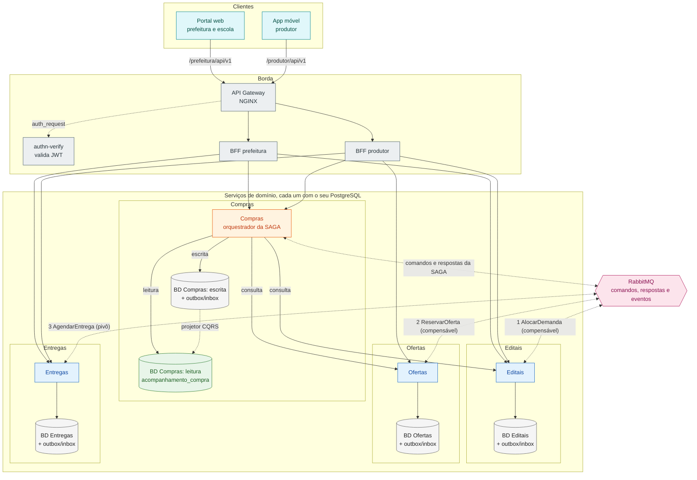

<h1 align="center" style="font-weight: bold;">
  CampoConecta
</h1>

<p align="center">
  
  
  
  
</p>

<p align="center">
  
  
  
  
  
  
  
</p>

<p align="center">
  
  
  
  
  
  
  
</p>

## 🌱 Sobre o Projeto

O CampoConecta é o sistema distribuído desenvolvido como Trabalho Prático da disciplina GCC129 (Sistemas Distribuídos, 2026/2). O objetivo da disciplina é que cada grupo constitua uma startup fictícia e desenvolva, ao longo do semestre, um sistema distribuído completo que resolva um problema real com impacto social identificável.

Neste projeto, a startup conecta produtores da agricultura familiar a prefeituras e escolas, viabilizando o cumprimento da cota mínima de 30% de compras institucionais exigida pela Lei do PNAE (Lei nº 11.947/2009).

## 🧩 O Problema

A Lei nº 11.947/2009 exige que ao menos 30% dos recursos do FNDE para merenda escolar sejam usados na compra de produtos da agricultura familiar. Apesar disso, cumprir essa cota está longe de ser trivial.

O próprio FNDE monitora as compras desde 2011 através do sistema SigPC, alimentado pelos gestores municipais e estaduais [1], e chegou a publicar um manual de dez passos só para orientar como comprar da agricultura familiar, incluindo o que fazer quando a chamada pública não acontece [2]. Isso já indica que o processo não é simples nem para quem o desenhou.

Um estudo sobre três municípios mineiros (Divinópolis, Guapé e Lavras) mostra que a compra da agricultura familiar vai muito além de conhecer a lei: gestores despreparados e agricultores desorganizados dificultam o acesso às chamadas públicas [3]. Pesquisas mais recentes relacionam esse desempenho desigual à capacidade administrativa de cada prefeitura [4]. Do lado da oferta, cooperativas de agricultura familiar também enfrentam dificuldades de acesso a esse mercado institucional, dado o número de agentes envolvidos no processo [5].

Existe, portanto, uma lacuna operacional real entre a obrigação legal e a capacidade prática de municípios e produtores executarem esse processo. É essa lacuna que o CampoConecta se propõe a resolver.

**📚 Referências**

1. FNDE. Dados da Agricultura Familiar. Disponível em: https://www.gov.br/fnde/pt-br/acesso-a-informacao/acoes-e-programas/programas/pnae/consultas/pnae-dados-da-agricultura-familiar
2. FNDE. Caderno de Compras da Agricultura Familiar para o PNAE. Disponível em: https://www.gov.br/fnde/pt-br/acesso-a-informacao/acoes-e-programas/programas/pnae/manuais-e-cartilhas/CadernoDeComprasAF_PNAE.pdf
3. Agricultura familiar e alimentação escolar: desafios para o acesso aos mercados institucionais em três municípios mineiros. SciELO. Disponível em: https://www.scielo.br/j/resr/a/BCkzGpHFdqbMChDYbTkcV4F/?lang=pt
4. Capacidades estatais municipais como condicionantes do desempenho das compras da agricultura familiar no âmbito do PNAE. SciELO. Disponível em: https://www.scielo.br/j/resr/a/sZF4VhcBZGBZ8F4d9k9dZbR/?format=pdf&lang=pt
5. As Cooperativas de Agricultura Familiar e o Mercado de Compras Governamentais em Minas Gerais. SciELO. Disponível em: https://www.scielo.br/j/resr/a/8DRytyzwCn4f84zpSpxVN8h/?format=html&lang=pt&ilang=en

## 🤝 Impacto Social

O CampoConecta gera impacto direto em três frentes principais:

- **Produtores familiares:** ganham acesso simplificado e desburocratizado a um mercado institucional estável, garantindo escoamento da produção e previsibilidade de renda.
- **Alunos da rede pública:** passam a receber uma alimentação escolar mais diversa, fresca e nutritiva, cumprindo o propósito original da legislação.
- **Prefeituras:** conseguem sair da situação de não conformidade legal com a cota do PNAE, reduzindo o esforço administrativo e burocrático.

Para acompanhar a efetividade da solução, o impacto social pode ser medido por meio das seguintes métricas:

- Percentual de chamadas públicas efetivamente preenchidas na região de atuação.
- Tempo médio entre a publicação do edital e a entrega efetiva dos alimentos nas escolas.
- Número de produtores certificados participando ativamente do sistema ao longo do tempo.
- Aumento no volume de compras da agricultura familiar realizadas por municípios parceiros.
- Índice de satisfação de escolas, gestores e produtores em relação ao processo de compra e entrega.

## 🚀 Visão Geral da Solução

O CampoConecta atua como uma ponte direta entre a oferta (produtores locais) e a demanda legal obrigatória (prefeituras e escolas), atacando as falhas de comunicação e organização do modelo atual. O sistema foca no fluxo de negócio prático para os usuários, operando da seguinte forma:

- **Publicação de Demanda:** A prefeitura cadastra e publica um edital de chamada pública detalhando os itens necessários, quantidades e prazos.
- **Propostas:** Os produtores familiares cadastrados visualizam os editais compatíveis com a sua produção e enviam suas propostas diretamente pela plataforma.
- **Alocação:** O sistema realiza a distribuição das compras entre os produtores, respeitando a capacidade produtiva de cada um e os critérios definidos no edital.
- **Logística:** A entrega dos alimentos é agendada e, posteriormente, confirmada fisicamente na escola recebedora.
- **Pagamento:** Após a confirmação do recebimento da mercadoria, o sistema libera o pagamento ao produtor.

<a id="visao-geral-arquitetura"></a>

## 🏗️ Visão Geral da Arquitetura e Comunicação

Os clientes acessam o sistema só pelo **API Gateway**, que valida o token no `authn-verify` e encaminha para o **BFF** de cada cliente. Os BFFs consultam os **quatro serviços de domínio**, cada um com o seu PostgreSQL (database per service). **Compras** orquestra a **SAGA** "confirmar compra" por mensagens no **RabbitMQ**, sempre via outbox, e mantém o **modelo de leitura do CQRS** (`acompanhamento_compra`).



Setas contínuas são chamadas HTTP; setas tracejadas são mensagens assíncronas (outbox → relay → RabbitMQ → inbox) ou a atualização da projeção CQRS. Os números são os passos da SAGA: **1 e 2 compensáveis, 3 pivô**, e o passo 4 (confirmar a compra, local em Compras) é **retentável**.

A legenda completa, o caminho de uma requisição, o diagrama da SAGA aplicada sobre os serviços e o que já está implementado estão em [**Visão geral da arquitetura**](docs/parte2/09-visao-geral-arquitetura.md).

## Executar a Parte 3

Pré-requisitos: Docker Engine ou Docker Desktop com contêineres Linux e Docker Compose v2.
No Windows, habilite a integração com a distribuição WSL se executar os comandos pelo Ubuntu.

Na raiz do repositório, prepare o ambiente uma vez:

```powershell
Copy-Item .env.example .env
# Edite .env: substitua as senhas e JWT_SECRET por valores próprios.
```

Use letras e números nas credenciais que entram nas URLs. `.env` é ignorado pelo Git;
`.env.example` contém somente exemplos. `JWT_SECRET` é usado pelo `authn-verify`
de desenvolvimento desta frente.

Com o `.env` configurado, um comando constrói as imagens e sobe o ambiente:

```sh
docker compose up -d --build
```

Para aguardar todos os healthchecks e conferir o resultado:

```sh
docker compose up -d --build --wait --wait-timeout 180
docker compose ps
```

Esta frente completa contém **treze contêineres**: gateway, authn-verify,
dois BFFs, quatro serviços FastAPI, quatro PostgreSQL e RabbitMQ. Todos devem
aparecer como `healthy`. A primeira construção baixa imagens e compila o
driver PostgreSQL; pode levar alguns minutos.

| Serviço | Operações implementadas nesta frente |
|---|---|
| Compras | `POST /api/v1/propostas`, `GET /api/v1/propostas/{id}` |
| Entregas | `POST /api/v1/capacidades`, `GET /api/v1/capacidades/{id}` |
| Todos os serviços de domínio | `GET /health`, consultando o próprio banco |
| Gateway | `/health` |
| authn-verify | emissão e validação JWT de desenvolvimento |
| BFF prefeitura | `GET /api/v1/dashboard` |
| BFF produtor | `GET /api/v1/inicio` |

Compras valida referências por HTTP em Editais e Ofertas e grava uma proposta
`ENVIADA`, sem reservar saldo. Entregas grava capacidades e rejeita janelas
sobrepostas para a mesma escola. Escritas exigem `Idempotency-Key` UUID e os
reenvios recuperam a resposta original. Migrações são aplicadas na inicialização.

Os serviços usam `aplicacao`, `mensageria` e somente sua rede `dados-*`. Cada banco
fica exclusivamente em sua rede interna; o RabbitMQ fica em `mensageria`, com
volume nomeado e healthcheck. A `borda` contém o gateway, o `authn-verify`
e os BFFs. O gateway é o único publicador externo na porta
`127.0.0.1:8080`; os BFFs ficam nas redes `borda + aplicacao`.

Para desenvolvimento, o override já existente permite acessar os Swagger de
Editais e Ofertas em `http://localhost:8001/docs` e `http://localhost:8002/docs`:

```sh
docker compose -f docker-compose.yml -f docker-compose.dev.yml up -d --build
```

Esse override publica portas de desenvolvimento e não faz parte da demonstração
final de entrada única pelo gateway. Compras e Entregas são verificados pela
rede interna, sem adicionar portas ao host.

### Verificação e demonstração

Com Python 3.10+ e o ambiente em execução, na raiz:

```sh
docker compose config --quiet
python3 scripts/verificar-parte3.py
python3 scripts/verificar-isolamento.py --sonda
```

O primeiro script testa as APIs e cria dados de demonstração persistentes. Como
a publicação de edital ainda não tem endpoint implementado, ele publica **somente
o edital de teste** por SQL executado pelo serviço Editais, dono daquele banco.
Não há endpoint público para criar compras nem publicação automática em produção.

A sonda comprova acesso às APIs e bloqueio dos quatro bancos por DNS e por IP
direto, a partir de um contêiner descartável na rede `aplicacao`, sem credenciais.
Após integrar os BFFs, execute a prova a partir do componente real:

```sh
python3 scripts/verificar-isolamento.py --bff bff-prefeitura
python3 scripts/verificar-isolamento.py --bff bff-produtor
```

O modo `--bff` exige o BFF no Compose e nas redes corretas; não substitui o
componente por uma sonda. O [roteiro do vídeo](docs/parte3/05-roteiro-video.md)
detalha a subida com volumes novos e as evidências a mostrar.

Para validar a borda após a subida:

```sh
py -3 scripts/verificar-borda.py
```

Para demonstrar manualmente a emissão de JWT e as duas respostas diferentes:

```powershell
$prefeitura = Invoke-RestMethod -Method Post -Uri http://127.0.0.1:8080/prefeitura/token `
  -ContentType application/json `
  -Body '{"sub":"gestor-1","papel":"gestor","instituicaoId":"00000000-0000-0000-0000-000000000001"}'

$produtor = Invoke-RestMethod -Method Post -Uri http://127.0.0.1:8080/produtor/token `
  -ContentType application/json `
  -Body '{"sub":"produtor-1","papel":"produtor","produtorId":"00000000-0000-0000-0000-000000000002"}'

Invoke-RestMethod -Headers @{Authorization="Bearer $($prefeitura.token)"} `
  -Uri http://127.0.0.1:8080/prefeitura/api/v1/dashboard

Invoke-RestMethod -Headers @{Authorization="Bearer $($produtor.token)"} `
  -Uri http://127.0.0.1:8080/produtor/api/v1/inicio
```

Para encerrar preservando os dados: `docker compose down`. Os quatro bancos e o
RabbitMQ usam volumes nomeados. As credenciais iniciais são aplicadas somente na
criação dos volumes; trocar o `.env` depois não altera as senhas já persistidas.

Limites desta etapa: autenticação/autorização por recurso e provisionamento de
vínculos institucionais ainda dependem da integração de borda e da conciliação
dos contratos. O modelo base mantém idempotência sem escopo por usuário.
RabbitMQ está preparado; SAGA, consumidores, outbox e CQRS entram na Parte 4.
Detalhes em [serviços, redes e mensageria](docs/parte3/04-servicos-redes-mensageria.md).
Os resultados reproduzidos estão no [relatório de validação](docs/parte3/VALIDACAO.md).

## 📚 Documentação

A documentação da **Parte 2 (arquitetura)** fica em `docs/`. O ponto de partida é a base comum, que fixa serviços, contratos e decisões compartilhadas por todos os documentos.

| Documento | Conteúdo |
|---|---|
| [Base comum](docs/parte2/00-base-comum.md) | Referência única: escopo, serviços, SAGA, CQRS, outbox e organização dos documentos |
| [Visão geral da arquitetura](docs/parte2/09-visao-geral-arquitetura.md) | Diagrama único de comunicação, caminho de uma requisição e a SAGA aplicada sobre os serviços (compensável, pivô e retentável) |
| [Serviços e fronteiras](docs/parte2/01-servicos.md) | Decomposição, justificativa das fronteiras, alternativas descartadas, diagramas e padrões |
| [Dados, consistência e outbox](docs/parte2/02-dados-outbox.md) | Modelo de dados, concorrência nas reservas, consistência eventual, outbox e inbox |
| [CQRS em Compras](docs/parte2/03-cqrs.md) | Modelo de escrita e leitura, projeção `AcompanhamentoCompra`, defasagem e reconstrução |
| [Gateway, BFFs e HATEOAS](docs/parte2/04-gateway-bffs.md) | Roteamento no NGINX, autenticação delegada, dois BFFs com respostas diferentes e links HATEOAS em Compra |
| [Contratos REST (OpenAPI)](docs/parte2/openapi/README.md) | Contratos OpenAPI 3.1 dos quatro serviços e dos dois BFFs, semântica HTTP, versionamento, paginação e idempotência |
| [SAGA: confirmar compra](docs/parte2/05-saga.md) | SAGA orquestrada, estados, compensações, sequências de sucesso e de falha, timeouts, recebimento e pagamento |
| [Catálogo de mensagens](docs/parte2/06-mensagens.md) | Envelope, comandos, respostas, eventos, roteamento no RabbitMQ e versionamento |
| [Princípios e padrões](docs/parte2/08-padroes-e-principios.md) | SOLID, padrões GoF e padrões arquiteturais aplicados ao projeto |
| [ADRs](docs/adr/README.md) | Decisões registradas com contexto, alternativas consideradas e consequências |
| [Plano de trabalho](docs/planejamento/plano-parte2.md) | Distribuição das frentes, tarefas e matriz de fechamento |
| [Plano da Parte 4](docs/planejamento/plano-parte4.md) | Sistema em funcionamento: front, SAGA, CQRS, assistente com LLM local, divisão e prazos |

> A Parte 2 é documental: não há sistema em execução nesta etapa. A implementação, os containers e a integração de LLM pertencem às Partes 3 e 4.

### Como validar os contratos

A Parte 2 não tem sistema executável. O que pode ser verificado são os contratos e a configuração do gateway. Na raiz do repositório, com Node.js e npm instalados:

```powershell
# Valida a sintaxe e as referências dos seis contratos OpenAPI
npm exec --yes --package=@redocly/cli@2.8.0 -- redocly lint docs/parte2/openapi/editais.openapi.json docs/parte2/openapi/ofertas.openapi.json docs/parte2/openapi/compras.openapi.json docs/parte2/openapi/entregas.openapi.json docs/parte2/openapi/bff-prefeitura.openapi.json docs/parte2/openapi/bff-produtor.openapi.json --extends minimal

# Confere cobertura das operações, origens dos BFFs e links HATEOAS dos exemplos
node docs/parte2/openapi/verificar-contratos.cjs
```

Os contratos também podem ser abertos em qualquer visualizador OpenAPI (por exemplo, o Swagger Editor). Os diagramas são escritos em Mermaid e aparecem renderizados ao abrir os arquivos `.md` no GitHub. O relatório completo das verificações está em [`openapi/VALIDACAO.md`](docs/parte2/openapi/VALIDACAO.md).

### Cobertura da rubrica

| Critério | Peso | Onde está a evidência |
|---|---:|---|
| Decomposição e fronteiras dos serviços | 15% | [`01-servicos.md`](docs/parte2/01-servicos.md) §2–§4, com diagramas em §8–§9; visão geral em [`09-visao-geral-arquitetura.md`](docs/parte2/09-visao-geral-arquitetura.md) |
| Contrato REST | 15% | [`openapi/`](docs/parte2/openapi/README.md): seis contratos, versionamento justificado e HATEOAS em Compra |
| Gateway e routing | 10% | [`04-gateway-bffs.md`](docs/parte2/04-gateway-bffs.md) §1–§2 e [`gateway/nginx`](docs/parte2/gateway/nginx/nginx.conf) |
| BFF (2 clientes distintos) | 10% | [`04-gateway-bffs.md`](docs/parte2/04-gateway-bffs.md) §3–§4 e os dois contratos de BFF |
| Database per service, consistência e outbox | 15% | [`02-dados-outbox.md`](docs/parte2/02-dados-outbox.md) §1–§10 |
| SAGA | 20% | [`05-saga.md`](docs/parte2/05-saga.md) §6–§9, a SAGA aplicada em [`09-visao-geral-arquitetura.md`](docs/parte2/09-visao-geral-arquitetura.md) §4 e [`06-mensagens.md`](docs/parte2/06-mensagens.md) |
| CQRS | 10% | [`03-cqrs.md`](docs/parte2/03-cqrs.md) |
| Apresentação e arguição | 5% | demonstração oral a partir destes documentos |

### Ajustes após a devolutiva da Parte 2

| Apontamento | Antes | Depois |
|---|---|---|
| Faltava uma visão geral da arquitetura | Cada padrão (SAGA, CQRS, outbox, gateway/BFF) tinha os seus diagramas, mas nenhum mostrava o sistema inteiro | [Diagrama geral](docs/parte2/09-visao-geral-arquitetura.md) com clientes, gateway, authn-verify, BFFs, serviços, bancos com outbox/inbox, RabbitMQ, CQRS e os passos da SAGA, também reproduzido [no topo deste README](#visao-geral-arquitetura) |
| A SAGA estava descrita, mas não aplicada à arquitetura | O fluxo era explicado em documento próprio, sem mostrar onde cada passo acontece nem o papel de cada passo | [SAGA aplicada sobre os serviços](docs/parte2/09-visao-geral-arquitetura.md#4-a-saga-aplicada-sobre-a-arquitetura), com cada passo classificado como compensável, pivô ou retentável, e a [classificação justificada](docs/parte2/05-saga.md#61-classificação-dos-passos-compensável-pivô-e-retentável) em `05-saga.md` |

A SAGA, o outbox/relay e a projeção CQRS estão **projetados** na Parte 2. A infraestrutura que eles usam (bancos isolados por serviço e RabbitMQ) já está em execução desde a Parte 3, e a implementação, com a demonstração de uma falha e da compensação, é entregue na Parte 4.

## 👥 Integrantes

<table align="center">
  <tr>
    <td align="center" width="33%">
      <a href="https://github.com/camidebem">
        <br />
        <sub><b>Camily Gonçalves de Bem</b></sub>
      </a>
    </td>
    <td align="center" width="33%">
      <a href="https://github.com/Clofender">
        <br />
        <sub><b>Daniel Silva Ferraz Neto</b></sub>
      </a>
    </td>
    <td align="center" width="33%">
      <a href="https://github.com/zector1">
        <br />
        <sub><b>José Victor Miranda de Oliveira</b></sub>
      </a>
    </td>
  </tr>
</table>

## Parte 3

[Vídeo de apresentação de todos os integrantes — terceira etapa](https://drive.google.com/file/d/1mvpnf018JTYjkTYtWUa8cwXK-2PbKOam/view?usp=sharing)

### Sistema rodando: apenas comandos

[Vídeo da subida do sistema completo e dos recursos em execução](docs/parte3/video/demonstracao-comandos.mp4): gravação do terminal mostrando o sistema completo subindo com um único comando e os recursos em execução.
