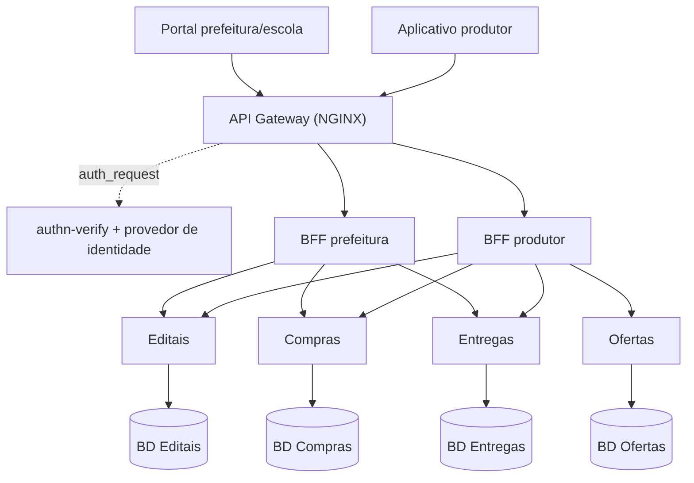
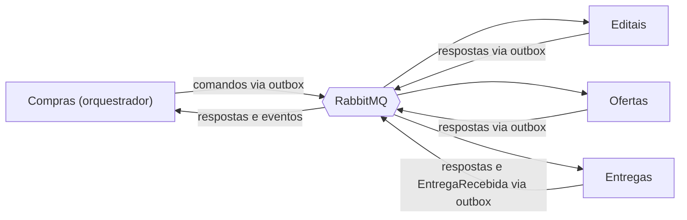

# CampoConecta — Base comum da Parte 2 (arquitetura)

**Disciplina:** GCC129 — Sistemas Distribuídos, 2026/2  
**Versão:** 1.1 — 18/10/2026  
**Objetivo:** estabelecer a arquitetura de referência do CampoConecta e permitir que três pessoas produzam a documentação da Parte 2 em paralelo, com contratos compatíveis.

> Este documento é uma base de projeto, não a descrição de um software já implementado. A decomposição, os contratos iniciais e as escolhas técnicas são decisões de projeto propostas pelo grupo. Se existir uma decisão diferente já aprovada, registrar a conciliação em um ADR antes de iniciar as tarefas dependentes.

**Histórico de versões**

| Versão | Mudanças |
|---|---|
| 1.0 | Primeira consolidação: serviços, SAGA, CQRS e divisão de tarefas |
| 1.1 | Alocação sugerida pelo sistema e homologada pelo gestor (fluxo original da Parte 1); criação única de compras por homologação; donos de Escola, Prefeitura, Produtor e Capacidade; gateway com `auth_request`; BFFs com diferenças concretas; HATEOAS com responsabilidades definidas; CQRS com justificativa por composição de dados e reconstrução sem replay do broker; plano de trabalho movido para anexo |

## 1. O que já está estabelecido e o que estamos propondo

| Origem | Conteúdo | Tratamento nesta base |
|---|---|---|
| Contexto geral (Parte 1) | Conectar agricultura familiar a prefeituras/escolas para compras de merenda escolar | Preservado |
| Contexto geral (Parte 1) | Publicar edital, receber propostas, **alocar compras entre produtores conforme capacidade e critérios do edital**, agendar e confirmar entrega, liberar pagamento | Preservado: a alocação é calculada pelo sistema como sugestão e homologada pelo gestor |
| Enunciado | Quatro serviços de domínio, bancos separados, dois clientes e dois BFFs, REST, gateway, SAGA, outbox e CQRS | Requisitos obrigatórios da arquitetura |
| Proposta desta base | Serviços Editais, Ofertas, Compras e Entregas; SAGA orquestrada; CQRS em Compras | Referência para os três responsáveis |

O contexto geral não contém bibliografia completa nem comprovação atualizada dos números legais citados. Preservar o embasamento da Parte 1, conferir as fontes originais e corrigir eventuais devolutivas; não transformar percentuais mencionados no contexto em regras fixas do software sem validação específica.

## 2. O que precisa ser entregue

A Parte 2 avalia **arquitetura documentada, contratos e justificativas**. Não exige sistema em execução. Protótipos são opcionais e não substituem os documentos.

| Requisito da Parte 2 | Evidência necessária | Peso |
|---|---|---:|
| Decomposição | Pelo menos quatro serviços, responsabilidades, justificativa das fronteiras e diagramas de componentes/comunicação | 15% |
| REST | Endpoints completos de cada serviço, verbos, códigos, versionamento e um recurso com HATEOAS | 15% |
| Gateway | Tecnologia, roteamento e responsabilidades | 10% |
| BFF | Dois clientes, dois BFFs, justificativa e respostas explicitamente diferentes | 10% |
| Dados | Instância de banco por serviço, tecnologia justificada, consistência eventual, dual write e outbox | 15% |
| SAGA | Uma variante justificada, transação em pelo menos três serviços, todas as compensações, sequência de sucesso e de falha | 20% |
| CQRS | Escrita/leitura separadas, justificativa, atualização e defasagem aceitável | 10% |
| Apresentação | Clareza e domínio na arguição | 5% |

**Calendário do enunciado:** apresentação em 22/10 ou 27/10; ordem sorteada em 20/10. Congelamento para todos os grupos em **21/10/2026, às 23h59**. Commits posteriores não contam para essa etapa.

Docker, Kubernetes, execução completa e integração de LLM/RAG pertencem às etapas seguintes. Aqui, apenas reservar pontos de integração futuros (por exemplo, os eventos de Compras podem alimentar uma base de conhecimento), sem torná-los entregas da Parte 2.

## 3. Escopo funcional compartilhado

1. A prefeitura cadastra suas escolas e publica um edital com itens, quantidades, escola de destino, prazo e **critérios de alocação** (lista ordenada e parametrizável).
2. O produtor mantém seu cadastro e suas ofertas e envia propostas vinculadas a itens do edital. A proposta é validada contra o edital e a oferta no momento do envio.
3. Para um edital, o sistema **gera um plano de alocação sugerido**: ordena as propostas elegíveis pelos critérios do edital e preenche o saldo de cada item respeitando a quantidade proposta. O gestor revisa, pode ajustar e **homologa** o plano.
4. Cada alocação homologada vira uma Compra e dispara uma SAGA que confirma a demanda, reserva a oferta e agenda a entrega.
5. A escola confirma o recebimento; a Compra é atualizada.
6. Compras registra a liberação de pagamento após o recebimento.

**Limites de projeto:** o sistema ordena, calcula saldo e propõe; a decisão e a responsabilidade jurídica da homologação são do gestor. Os critérios de alocação são dados do edital, e o algoritmo de ordenação é uma função determinística sobre eles (detalhado nos documentos de Compras). Uma Compra representa uma alocação de **uma proposta de um produtor**, com quantidade menor ou igual à proposta; uma demanda pode ser atendida por várias compras, respeitando seu saldo.

**Pagamento:** a liberação é um estado de negócio sob responsabilidade de Compras. Não representa transferência bancária. Um serviço financeiro independente pode ser introduzido depois, se houver necessidade real.

**Clientes:** portal web para prefeitura/escola e aplicativo móvel para o produtor. As necessidades de cada cliente diferem de forma concreta (seção 6.3), o que justifica um BFF para cada um.

## 4. Fronteiras dos quatro serviços

| Serviço | Responsabilidade exclusiva | Entidades principais | Não deve fazer |
|---|---|---|---|
| Editais | Demanda pública: instituições demandantes, editais e saldo de cada item | Prefeitura, Escola, Edital, ItemEdital, AlocacaoDemanda | Reservar produção ou agendar entrega |
| Ofertas | Produtores, produção disponível e reservas por compra | Produtor, Oferta, ReservaOferta | Julgar proposta ou controlar pagamento |
| Compras | Propostas, plano de alocação, compra, orquestração da SAGA e liberação de pagamento | Proposta, PlanoAlocacao, Compra, SagaCompra, LiberacaoPagamento, projeção `AcompanhamentoCompra` | Alterar bancos de outros serviços |
| Entregas | Capacidade logística, agendamento e recebimento | CapacidadeLogistica, Agendamento, Entrega, ConfirmacaoRecebimento | Definir disponibilidade de produção |

**Por que essas fronteiras:** demanda pública, capacidade de fornecimento, compromisso comercial e logística têm regras e ciclos de vida próprios. Separá-los permite transações locais e compensações explícitas. Um serviço genérico de cadastros teria pouca autonomia de negócio; dividir cada tabela em um serviço aumentaria a comunicação sem uma fronteira útil. Escola e Prefeitura ficam em Editais porque são o lado da demanda e são referenciadas pelos itens do edital; Produtor fica em Ofertas porque a identidade do produtor e sua produção evoluem juntas.

**Identidade e vínculo:** usuários, senhas e papéis ficam no provedor de identidade (infraestrutura, não serviço de domínio). O token JWT carrega as claims `papel` (`gestor`, `escola`, `produtor`) e `instituicaoId` (prefeitura ou escola) ou `produtorId`. Os serviços verificam o vínculo comparando a claim com o dono do recurso (por exemplo, Entregas exige `escolaId` da entrega igual à `instituicaoId` do token no recebimento). O provisionamento do vínculo entre usuário e instituição/produtor acontece no cadastro e fica fora do escopo da Parte 2.

**Regra de autoridade:** todo dado tem um único serviço dono. IDs de outros serviços são referências externas, sem chave estrangeira entre bancos. Quando um serviço guarda cópia de dado alheio para consulta (nome da escola, produto, unidade), a cópia é um **snapshot** imutável com `snapshotAt`, nunca fonte de verdade. BFFs agregam via APIs e não consultam bancos. As validações decisivas ocorrem no serviço dono, mesmo quando existe snapshot ou projeção.

## 5. Plataforma de referência e comunicação

Estas escolhas são propostas para reduzir decisões independentes; não são exigências da disciplina.

| Elemento | Escolha de referência | Motivo de projeto |
|---|---|---|
| Serviços e BFFs | Python + FastAPI | Padronizar contratos REST e reduzir diversidade de ferramentas |
| Gateway | NGINX com `auth_request` | Roteamento explícito, rate limiting e entrada única; a validação de JWT é delegada (seção 6.3) |
| Validação de token | Componente `authn-verify` (sem banco), atrás do `auth_request` | O NGINX de código aberto não valida JWT nativamente |
| Bancos | PostgreSQL, uma instância por serviço | Transações locais para entidades e outbox; operação uniforme |
| Mensageria | RabbitMQ | Separar comunicação assíncrona dos processos HTTP |
| Clientes | Portal web da prefeitura/escola; aplicativo móvel do produtor | Necessidades de apresentação diferentes |
| Autenticação | Provedor de identidade OIDC (por exemplo, Keycloak); tokens JWT | Evitar construir autenticação própria |

A escolha de framework de frontend fica para a implementação. Se o grupo adotar outra stack, substituir esta tabela uma única vez e preservar os contratos.





Os dois diagramas mostram, respectivamente, o acesso HTTP com a propriedade dos bancos e a comunicação assíncrona. O diagrama de comunicação entregue na documentação deve unir ambos e acrescentar o relay do outbox e a inbox de cada consumidor.

**Regras de comunicação**

- HTTP/REST: clientes, gateway, BFFs e consultas síncronas entre serviços.
- Comandos e eventos assíncronos: SAGA e atualização de projeções.
- Uma transação de banco nunca atravessa serviços.
- O gateway trata entrada, roteamento e autenticação. Serviços aplicam autorização e regras do domínio. BFFs adaptam e agregam respostas.
- **Validação no envio da proposta:** Compras consulta por HTTP Editais (edital publicado, item existente, unidade) e Ofertas (oferta ativa e pertencente ao produtor), grava o resultado como snapshot na proposta e responde `503` sem persistir se uma dependência estiver indisponível. Essa validação é consultiva; a confirmação decisiva de saldo e de produção ocorre na SAGA.

## 6. Contratos mínimos comuns

### 6.1 Convenções

- IDs: UUID; quantidades com unidade explícita; valores monetários decimais com moeda, sem ponto flutuante binário.
- Datas: ISO 8601 com fuso; nomes JSON em `camelCase`.
- REST: `/api/v1`; evolução compatível mantém a versão; quebra de contrato exige nova versão e plano de transição.
- HTTP: `201` criação concluída; `202` processamento assíncrono iniciado; `400` formato inválido; `401` sem autenticação; `403` sem permissão; `404` ausente; `409` conflito de estado ou capacidade; `503` dependência indisponível.
- Erros: `code`, `message`, `details` e `correlationId`, sem detalhes internos sensíveis.
- Comandos HTTP reenviáveis: `Idempotency-Key`, associado ao ator e à operação. Mesma chave e mesmo conteúdo retorna o resultado original; conteúdo diferente gera conflito.
- Toda mensagem: `messageId`, `type`, `schemaVersion`, `occurredAt`, `correlationId`, `causationId`, `aggregateId` e `payload`. Mensagens de SAGA incluem `sagaId` e `operationId`.
- Versionamento por agregado e deduplicação por consumidor; não presumir entrega exatamente uma vez nem ordem global.

### 6.2 Superfície mínima de APIs

Esta lista fixa os recursos compartilhados. O contrato OpenAPI final completa parâmetros, schemas, exemplos, autorização, erros e demais operações do ciclo de vida.

| Serviço | Recursos e operações mínimas |
|---|---|
| Editais | `POST /prefeituras`; `GET /prefeituras/{id}`; `POST /escolas`; `GET /escolas`; `GET /escolas/{id}`; `POST /editais`; `GET /editais`; `GET /editais/{id}`; `PATCH /editais/{id}`; `POST /editais/{id}/publicacoes`; `POST /editais/{id}/encerramentos` |
| Ofertas | `POST /produtores`; `GET /produtores/{id}`; `PATCH /produtores/{id}`; `POST /ofertas`; `GET /ofertas`; `GET /ofertas/{id}`; `PATCH /ofertas/{id}`; `GET /reservas/{id}` |
| Compras | `POST /propostas`; `GET /propostas`; `GET /propostas/{id}`; `POST /propostas/{id}/retiradas`; `POST /planos-alocacao`; `GET /planos-alocacao/{id}`; `PATCH /planos-alocacao/{id}`; `POST /planos-alocacao/{id}/homologacoes`; `GET /compras`; `GET /compras/{id}`; `GET /compras/{id}/acompanhamento`; `GET /compras/{id}/liberacao-pagamento` |
| Entregas | `POST /capacidades`; `GET /capacidades`; `PATCH /capacidades/{id}`; `GET /entregas`; `GET /entregas/{id}`; `POST /entregas/{id}/recebimentos` |

Todos os caminhos são relativos a `/api/v1`.

**Criação de compras:** não existe `POST /compras` público. Compras nascem **somente** da homologação: `POST /planos-alocacao/{id}/homologacoes` (gestor autorizado, com `Idempotency-Key`) responde `202`, cria uma Compra `PENDENTE` por item do plano e inicia uma SAGA independente para cada uma. A resposta aponta para o plano, que expõe o status de cada item. `POST /planos-alocacao` gera a sugestão para um edital e responde `201`; `PATCH` permite ao gestor ajustar quantidades ou excluir itens antes da homologação.

Reservar/liberar demanda, reservar/liberar oferta e agendar/cancelar entrega são comandos internos via broker; não são endpoints públicos. O recebimento exige papel `escola` e vínculo com a escola da entrega.

### 6.3 Gateway, BFFs e HATEOAS

**Rotas externas do gateway**

| Entrada externa | Destino | Regra |
|---|---|---|
| `/prefeitura/api/v1/*` | BFF prefeitura | Papel `gestor` ou `escola`; demais papéis recebem `403` |
| `/produtor/api/v1/*` | BFF produtor | Papel `produtor`; demais papéis recebem `403` |
| `/health` | Respondido pelo próprio gateway | Público |

**Rotas internas (BFF para serviço):** o BFF prefeitura acessa Editais, Compras e Entregas; o BFF produtor acessa Editais, Ofertas, Compras e Entregas, sempre em `http://<serviço>:<porta>/api/v1`. As APIs de domínio não são expostas fora da rede interna.

**Responsabilidades do gateway**

| Responsabilidade | Como |
|---|---|
| Entrada única e TLS | Terminação TLS no NGINX |
| Autenticação | `auth_request` para o `authn-verify`, que valida assinatura e expiração do JWT com as chaves públicas (JWKS) do provedor e devolve as claims |
| Autorização grossa | Compatibilidade entre `papel` e prefixo da rota |
| Rate limiting | `limit_req` por IP e por identidade |
| Proteção de entrada | Limite de tamanho de corpo, CORS e remoção de cabeçalhos de identidade enviados pelo cliente |
| Rastreabilidade | Gera `X-Correlation-Id` quando ausente e o propaga; logs de acesso |

O gateway **não** agrega respostas, não aplica regra de negócio nem autoriza por recurso: isso cabe aos BFFs e aos serviços. Alternativas avaliadas para a autenticação: Envoy (`jwt_authn`, validação nativa, configuração mais verbosa), Kong e Traefik (ForwardAuth); o NGINX foi escolhido pela simplicidade de rotas explícitas.

**Por que dois BFFs:** os clientes diferem em dispositivo, rede, perfil de uso e volume de dados.

| Aspecto | BFF prefeitura (portal web) | BFF produtor (aplicativo móvel) |
|---|---|---|
| Perfil de uso | Supervisão, planejamento e decisão em tela ampla | Consulta rápida e ações curtas, rede móvel instável |
| Agregação própria | `GET /dashboard`: editais abertos, saldo por item, compras por status, entregas atrasadas (Editais, Compras, Entregas) | `GET /inicio`: minhas propostas, próximas entregas, editais compatíveis com minhas ofertas (Editais, Ofertas, Compras, Entregas) |
| Listagens | Paginação por página (até 50 itens), filtros, ordenação e colunas completas | Paginação por cursor (10 itens) e campos mínimos |
| Ações principais | Publicar/encerrar edital, ajustar e homologar plano, confirmar recebimento (escola) | Manter oferta, enviar e retirar proposta |
| Sincronização | Consulta direta | `ETag`/`If-None-Match` e `?atualizadoDesde=` para sincronização incremental |
| Formato | Objetos aninhados com produtor, escola e histórico | Payload achatado, apenas o necessário ao produtor |

Notificações push para o aplicativo ficam reservadas para etapa futura.

Exemplos da diferença para o mesmo recurso (acompanhamento de uma compra):

```json
{
  "cliente": "prefeitura",
  "compraId": "uuid-compra",
  "status": "CONFIRMADA",
  "edital": {"id": "uuid-edital", "titulo": "Edital exemplo"},
  "produtor": {"id": "uuid-produtor", "nome": "Produtor exemplo"},
  "escola": {"id": "uuid-escola", "nome": "Escola exemplo"},
  "quantidade": {"valor": "100.00", "unidade": "kg"},
  "entrega": {"status": "AGENDADA", "data": "2026-11-25"},
  "pagamento": {"status": "AGUARDANDO_RECEBIMENTO"},
  "atualizadoEm": "2026-10-18T14:00:00-03:00"
}
```

```json
{
  "cliente": "produtor",
  "compraId": "uuid-compra",
  "status": "CONFIRMADA",
  "produto": "Arroz",
  "quantidade": {"valor": "100.00", "unidade": "kg"},
  "localEntrega": "Escola exemplo",
  "dataEntrega": "2026-11-25",
  "pagamento": "AGUARDANDO_RECEBIMENTO"
}
```

E uma visão agregada de cada cliente:

```json
{
  "cliente": "prefeitura",
  "recurso": "dashboard",
  "editaisAbertos": 3,
  "itens": [{"itemEditalId": "uuid-item", "produto": "Arroz", "saldo": {"valor": "250.00", "unidade": "kg"}}],
  "comprasPorStatus": {"PENDENTE": 2, "CONFIRMADA": 7, "RECEBIDA": 4, "CANCELADA": 1},
  "entregasAtrasadas": 1
}
```

```json
{
  "cliente": "produtor",
  "recurso": "inicio",
  "propostas": [{"id": "uuid-proposta", "status": "ALOCADA"}],
  "proximasEntregas": [{"compraId": "uuid-compra", "data": "2026-11-25"}],
  "editaisCompativeis": 2,
  "cursor": "opaco"
}
```

**HATEOAS no recurso Compra.** Responsabilidades:

- O serviço Compras monta os links dos **seus** recursos e das **ações permitidas** (`self`, `acompanhamento`, `liberacao-pagamento`), condicionados ao estado da Compra e ao papel nas claims, com `href` relativos ao domínio.
- Cada BFF reescreve os `href` para o prefixo do próprio gateway e acrescenta os links de recursos de outros serviços (`edital`, `entrega`) e a ação `confirmar-recebimento`.
- `confirmar-recebimento` (`POST /prefeitura/api/v1/entregas/{id}/recebimentos`) só aparece no BFF prefeitura, para o papel `escola` com vínculo com a escola da entrega e com entrega `AGENDADA`. Gestor e produtor não recebem esse link.
- A API valida a ação mesmo quando o cliente já possui o link.

```json
{
  "compraId": "uuid-compra",
  "status": "CONFIRMADA",
  "_links": {
    "self": {"href": "/prefeitura/api/v1/compras/uuid-compra"},
    "acompanhamento": {"href": "/prefeitura/api/v1/compras/uuid-compra/acompanhamento"},
    "edital": {"href": "/prefeitura/api/v1/editais/uuid-edital"},
    "entrega": {"href": "/prefeitura/api/v1/entregas/uuid-entrega"},
    "confirmar-recebimento": {"href": "/prefeitura/api/v1/entregas/uuid-entrega/recebimentos", "method": "POST"}
  }
}
```

Os exemplos usam IDs ilustrativos e serão ajustados aos schemas UUID finais.

## 7. SAGA de referência: confirmar compra

**Variante única:** orquestrada, com estado persistido em Compras. A escolha concentra progresso, timeouts e compensações de um processo com várias etapas. A alternativa coreografada distribuiria esse controle entre os participantes e dificultaria reconstruir o fluxo e auditar compensações. Eventos continuam sendo usados; isso não transforma a SAGA em coreografada.

**Gatilho:** a homologação de um plano cria N Compras e inicia **uma SAGA independente por Compra**. A falha de uma não desfaz as demais; o plano mostra o status de cada item.

**Pré-condições:** plano homologado por gestor autorizado, edital publicado e vínculos válidos. As quantidades são confirmadas atomicamente pelos serviços donos durante a SAGA; a sugestão do plano e as consultas prévias não garantem disponibilidade. Várias SAGAs podem disputar o mesmo item do edital ou a mesma oferta: a reserva atômica em cada serviço decide.

| Passo | Dono e comando | Efeito local | Compensação |
|---|---|---|---|
| 0 | Compras: iniciar | Compra `PENDENTE`, SAGA `EM_ANDAMENTO` e comando inicial no outbox | Registrar Compra `CANCELADA` após compensações concluídas |
| 1 | Editais: `AlocarDemanda` | Reservar saldo do item do edital para esta compra | `LiberarDemanda` |
| 2 | Ofertas: `ReservarOferta` | Reservar produção sem permitir saldo negativo | `LiberarOferta` |
| 3 | Entregas: `AgendarEntrega` | Reservar capacidade e registrar agendamento | `CancelarAgendamento` |
| 4 | Compras: concluir | Compra `CONFIRMADA`, SAGA `CONCLUIDA` e evento no outbox | Finalização local repetível; cancelamento posterior é outro processo |

Incluir Editais evita que duas compras excedam a mesma demanda, mesmo havendo produção suficiente. A transação atravessa quatro serviços, superando o mínimo de três.

**Estados:** a Compra permanece `PENDENTE` durante a execução e a compensação; a SAGA percorre `EM_ANDAMENTO`, `COMPENSANDO`, `CONCLUIDA` e `CANCELADA`.

**Mensagens canônicas:** cada comando recebe resposta de sucesso ou rejeição: `DemandaAlocada`/`AlocacaoDemandaRejeitada`, `OfertaReservada`/`ReservaOfertaRejeitada`, `EntregaAgendada`/`AgendamentoRejeitado`; também há respostas às três compensações. O comando `AgendarEntrega` leva `escolaId`, `itemEditalId`, `quantidade`, janela de entrega (derivada do prazo do edital) e `produtorId`. Schemas, filas e chave de deduplicação são detalhados no catálogo de mensagens.

**Falhas obrigatórias a documentar:**

1. Demanda indisponível: rejeitar a compra, sem reserva a desfazer.
2. Oferta indisponível: liberar a demanda e cancelar a compra.
3. Agendamento rejeitado: liberar a oferta, liberar a demanda e cancelar a compra.
4. Timeout com resultado desconhecido: não assumir falha; repetir com o mesmo `operationId`. Se houver cancelamento, cancelar também um eventual agendamento já efetivado.
5. Resposta tardia: o participante mantém o estado por operação; um cancelamento anterior impede recriar a reserva ou o agendamento para a mesma operação. O orquestrador reconcilia o resultado e confirma as compensações.
6. Compensação indisponível: manter `COMPENSANDO`, repetir com backoff e limite por janela, registrar a pendência e prever intervenção. Não marcar `CANCELADA` enquanto houver efeito conhecido não desfeito.

Compensações são operações de negócio idempotentes, não rollback global. Compras registra cada transição e o próximo comando em transação local; após reinício, continua do estado persistido.

**Recebimento e pagamento:** fora desta SAGA, Entregas registra o recebimento e publica `EntregaRecebida` via outbox. Compras consome com deduplicação, marca a Compra `RECEBIDA` e registra uma única liberação de pagamento na mesma transação local. Reprocessamento não libera duas vezes. Esse fluxo preserva a visão original do projeto.

**Entregas documentais:** sequência completa de sucesso (incluindo homologação e a primeira SAGA); sequência com rejeição no agendamento e compensações; tabela de estados e transições; matriz de comandos e eventos; explicação de timeout e compensação incompleta.

## 8. Dados, outbox e CQRS

### 8.1 Persistência e consistência

- Cada serviço tem instância PostgreSQL e credenciais próprias; quatro schemas em uma única instância não atendem ao enunciado. PostgreSQL em todos os serviços é uma escolha deliberada: transações ACID para reservas e outbox e operação uniforme; a diversidade de tecnologia não traria benefício neste domínio.
- Operações de capacidade usam transação local e controle de concorrência; a estratégia escolhida (por exemplo, bloqueio otimista por versão ou `UPDATE` condicional do saldo) é documentada para impedir excesso de alocação e de reserva.
- Referências entre serviços não criam acesso SQL cruzado.
- Snapshots, projeções e estados vistos por outros serviços podem atrasar; decisões críticas consultam ou alteram o dono do dado.
- **Pontos de consistência eventual:** projeção `AcompanhamentoCompra`; snapshots de proposta; estado da compra visto pelos BFFs durante a SAGA; reconhecimento de recebimento entre Entregas e Compras.

### 8.2 Outbox comum

O risco de dual write aparece quando o serviço confirma uma alteração no banco e publica uma mensagem separadamente. Se ocorrer falha entre as duas ações, banco e consumidores divergem.

**Projeto obrigatório:** a transação local grava a entidade e uma linha de outbox. Um relay publica as linhas pendentes no broker e marca a publicação após a confirmação. Se cair entre publicar e marcar, poderá publicar novamente; os consumidores deduplicam por `messageId` em uma inbox gravada na mesma transação dos efeitos locais.

Campos mínimos do outbox: `messageId`, `type`, `aggregateId`, `aggregateVersion`, `payload`, `occurredAt`, `publishedAt` e `attempts`. Documentar retries, observabilidade, mensagens rejeitadas (fila de mensagens mortas) e recuperação. Aplicar o padrão aos comandos e eventos duráveis da SAGA, às transições de Compra e a `EntregaRecebida`.

### 8.3 CQRS em Compras

**Justificativa:** com um banco por serviço, não há JOIN entre bancos. O acompanhamento de uma compra precisa combinar dados de Compras (estado e SAGA), de Editais (título do edital e escola), de Ofertas (produtor e produto) e de Entregas (agendamento e recebimento). Sem uma projeção, cada consulta dos BFFs exigiria chamadas a quatro serviços e a reconstrução do progresso da SAGA. A projeção serve essa leitura frequente com uma única consulta.

| Aspecto | Decisão de referência |
|---|---|
| Escrita | Propostas, planos de alocação, compras, estado da SAGA e liberações de pagamento, normalizados |
| Leitura | Projeção `AcompanhamentoCompra`: `compraId`, `editalId`, `editalTitulo`, `produtorId`, `produtorNome`, `escolaId`, `escolaNome`, `produto`, `quantidade`, `status`, `etapaSaga`, `entrega {status, data}`, `pagamento {status}`, `updatedAt`, `versao` |
| Origem dos dados | Nomes e produto vêm dos snapshots da proposta; entrega e pagamento vêm dos dados das respostas da SAGA e de `EntregaRecebida`, gravados no modelo de escrita |
| Separação física | Tabelas de leitura próprias na instância de Compras; um banco adicional não é obrigatório |
| Atualização | Cada transição do modelo de escrita publica um evento de Compras pelo outbox; um projetor consome com inbox e `versao` para não regredir o estado com mensagem antiga |
| Defasagem | Meta de até 5 segundos em operação normal no ambiente de teste; ainda não medida |
| Transparência | A resposta inclui `updatedAt`; a interface indica estado pendente e permite nova consulta |
| Recuperação | Reprocessamento idempotente de eventos pendentes e **reconstrução completa a partir das tabelas do modelo de escrita**, sem depender de reler o broker, que não retém mensagens já consumidas em filas convencionais |

CQRS aqui não exige event sourcing. A projeção não decide saldo de oferta, saldo de edital nem autorização de pagamento. Os mesmos eventos de Compras servem de ponto de integração futuro (por exemplo, base de conhecimento).

## 9. Organização dos documentos

Usar este documento como `docs/parte2/00-base-comum.md` e, no README da raiz, incluir link para ele e para o índice dos demais. Os caminhos abaixo são as entregas planejadas.

| Caminho sugerido | Conteúdo |
|---|---|
| `README.md` | Nome, problema, integrantes, estágio atual, navegação e instruções disponíveis |
| `docs/parte2/00-base-comum.md` | Esta referência |
| `docs/parte2/01-servicos.md` | Fronteiras e diagramas de componentes e de comunicação |
| `docs/parte2/02-dados-outbox.md` | Bancos, consistência, concorrência e outbox |
| `docs/parte2/03-cqrs.md` | Modelos, atualização, defasagem e recuperação |
| `docs/parte2/openapi/` | Um contrato por serviço e por BFF |
| `docs/parte2/04-gateway-bffs.md` | Rotas, responsabilidades, exemplos e HATEOAS |
| `docs/parte2/05-saga.md` | Estados, passos, compensações e sequências |
| `docs/parte2/06-mensagens.md` | Envelope, comandos, eventos e exemplos |
| `docs/parte2/07-validacao.md` | Matriz de cobertura e roteiro de apresentação |
| `docs/adr/` | Decisões com contexto, alternativas e consequências |

Na Parte 2, o README deve explicar como consultar e validar os contratos e diagramas e declarar honestamente o que ainda não é executável. As instruções para subir o sistema completo entram quando a implementação existir.

## 10. Fontes e limites

1. **Contexto geral do projeto** (documento da Parte 1): domínio, beneficiários e fluxo funcional original.
2. **Enunciado do trabalho GCC129**, versão de 06/10/2026: requisitos, rubrica, calendário e regras de contribuição.
3. **Decisões de projeto** consolidadas neste documento e registradas em ADR.

Este documento não substitui as entregas detalhadas. Seu papel é fixar o ponto de partida comum, rastrear requisitos e evitar que os responsáveis projetem sistemas diferentes.
