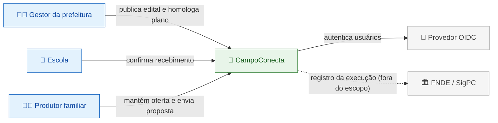
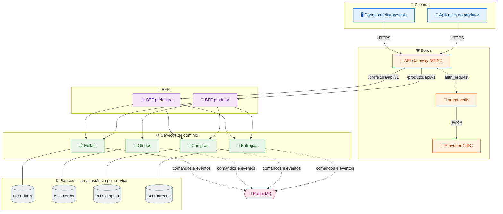
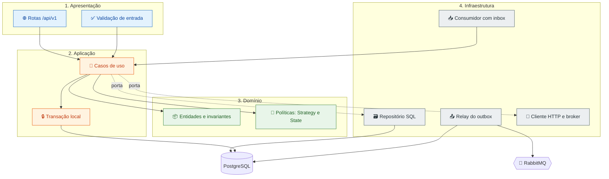
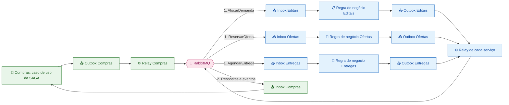

# Serviços, fronteiras e organização interna

> Entrega **P1-01** (decomposição em serviços e justificativa das fronteiras) e **P1-02** (diagramas de componentes e de comunicação).
> Referência comum: [`00-base-comum.md`](./00-base-comum.md). Decisões registradas em [`docs/adr/`](../adr/).

## 1. Escopo deste documento

Neste documento fixamos **quatro serviços de domínio**, explicamos por que a fronteira foi desenhada assim, quais alternativas descartamos e como cada serviço se organiza internamente. Nesta etapa não há implementação: as decisões são de projeto, e os padrões citados indicam **onde** eles serão aplicados na Parte 4, não um sistema já executável.

### 1.1 Rastreabilidade dos requisitos

| Requisito da Parte 2 | Onde atendemos |
|---|---|
| Pelo menos quatro serviços independentes | Seção 2 |
| Responsabilidade de cada serviço | Seção 2 |
| Justificativa das fronteiras | Seções 3 e 4 |
| Diagrama de componentes | Seção 8.2 |
| Diagrama de comunicação | Seções 8.3 e 9 |
| Banco por serviço e dono de cada dado | Seção 5 e [`02-dados-outbox.md`](./02-dados-outbox.md) |
| Padrões e princípios aplicados | Seção 7 e [`08-padroes-e-principios.md`](./08-padroes-e-principios.md) |

## 2. Quadro dos serviços

| Serviço | Responsabilidade exclusiva | Entidades principais | Não deve fazer |
|---|---|---|---|
| **Editais** | Demanda pública: instituições demandantes, editais e saldo de cada item | `Prefeitura`, `Escola`, `Edital`, `ItemEdital`, `AlocacaoDemanda` | Reservar produção ou agendar entrega |
| **Ofertas** | Produtores, produção disponível e reservas por compra | `Produtor`, `Oferta`, `ReservaOferta` | Julgar proposta ou controlar pagamento |
| **Compras** | Propostas, plano de alocação, compra, orquestração da SAGA e liberação de pagamento | `Proposta`, `PlanoAlocacao`, `Compra`, `SagaCompra`, `LiberacaoPagamento`, projeção `AcompanhamentoCompra` | Alterar bancos de outros serviços |
| **Entregas** | Capacidade logística, agendamento e recebimento | `CapacidadeLogistica`, `Agendamento`, `Entrega`, `ConfirmacaoRecebimento` | Definir disponibilidade de produção |

Além dos quatro serviços existem componentes de **infraestrutura**, que não são serviços de domínio: API Gateway, `authn-verify`, provedor de identidade OIDC, broker de mensagens e os quatro bancos.

## 3. Justificativa das fronteiras

Adotamos como critério de corte **ciclo de vida e regra de negócio própria**, não o modelo de dados. Assim, cada serviço abaixo pode evoluir suas regras sem exigir alteração coordenada nos demais.

### 3.1 Editais — o lado da demanda

- **Regra própria:** publicar e encerrar edital, manter o saldo de cada `ItemEdital` e registrar reservas de demanda (`AlocacaoDemanda`).
- **Por que `Prefeitura` e `Escola` ficam aqui:** são os donos da demanda e o motivo pelo qual o edital existe. O edital referencia a escola de destino; manter instituição e edital no mesmo serviço permite validar "escola pertence à prefeitura que publica" em uma transação local, sem chamada remota no caminho crítico.
- **O que fica fora:** dados de produtor, de compra e de logística. O serviço não sabe se existe produção suficiente — apenas se o saldo do item ainda permite reservar.
- **Consequência aceita:** um cadastro de escola usado por outro contexto (por exemplo, relatório logístico) precisa de *snapshot* no consumidor, porque não há acesso SQL cruzado.

### 3.2 Ofertas — o lado da oferta

- **Regra própria:** manter produtor, oferta e reserva de produção (`ReservaOferta`), impedindo saldo negativo.
- **Por que `Produtor` fica aqui:** a identidade do produtor e sua produção evoluem juntas (novo produtor nasce com ofertas; produtor inativo deixa de ofertar). Separar pessoa de produção criaria uma chamada remota em toda validação de proposta sem ganho de autonomia.
- **O que fica fora:** preço, julgamento de proposta e pagamento. Ofertas responde apenas "existe produção reservável para este produtor?".
- **Consequência aceita:** a proposta guarda *snapshot* de produto e unidade; se o produtor renomear a oferta, os documentos já emitidos não mudam retroativamente.

### 3.3 Compras — o compromisso comercial

- **Regra própria:** receber propostas, gerar e homologar plano de alocação, criar compras, orquestrar a SAGA e registrar a liberação de pagamento.
- **Por que agrupa quatro responsabilidades:** proposta, plano, compra e SAGA compartilham **a mesma transação de negócio**. Se o plano ficasse em outro serviço, cada homologação viraria uma chamada remota com estado parcial, e o orquestrador ficaria sem transação local para registrar progresso e o próximo comando. A liberação de pagamento é um estado de negócio derivado do recebimento, e manter isso aqui evita um serviço financeiro sem função real nesta fase.
- **Por que não é um "serviço-deus":** internamente é dividido em módulos (seção 6.3), cada um com regra e repositório próprios, e ele **não** altera dados de Editais, Ofertas ou Entregas — apenas envia comandos.
- **O que fica fora:** saldo de edital e saldo de oferta. Compras **propõe**, os donos **decidem** na SAGA.

### 3.4 Entregas — a logística

- **Regra própria:** capacidade logística, janela de agendamento e confirmação física de recebimento.
- **Por que separado:** a logística tem ciclo de vida e sazonalidade próprios (capacidade por período), e o recebimento é o **fato externo** que dispara o pagamento. Isolar esse fato permite que `EntregaRecebida` seja publicado por outbox sem que Entregas conheça a regra de pagamento.
- **O que fica fora:** disponibilidade de produção e valor da compra.

## 4. Alternativas de decomposição descartadas

| Alternativa | Por que foi descartada | Consequência de tê-la adotado |
|---|---|---|
| **Um único serviço de cadastros** (pessoas, escolas, produtos) | Baixa autonomia de negócio: só faz CRUD e todos os demais serviços dependeriam dele para qualquer operação | Acoplamento em cadeia e uma SAGA sem participante real de domínio |
| **Um serviço por tabela** | Aumenta a comunicação sem criar fronteira útil; `Compra` e `Proposta` mudariam sempre juntas | Muitas chamadas para completar uma única transação |
| **Serviço de Instituições** (prefeitura e escola separadas de Editais) | Escola e prefeitura só existem, neste domínio, como demandantes de edital; separá-las cria chamada remota na publicação | Validação distribuída no caminho crítico do edital |
| **Serviço de Pessoas** (produtor separado de Ofertas) | O produtor não tem regra própria além de ofertar; a entidade é acessória da oferta | Uma consulta remota a mais em toda validação de proposta |
| **Fundir Editais + Compras** | Demanda pública e compromisso comercial têm ciclos distintos: edital vive meses e é reaproveitado por várias compras | Um serviço com duas razões para mudar (violação de SRP) e compensações internas disfarçadas |
| **Serviço financeiro de Pagamento** | Nesta fase o pagamento é apenas um estado de negócio após o recebimento, não uma transferência | Serviço sem domínio real, mantido só para cumprir contagem |
| **Orquestrador como serviço autônomo** (process manager separado de Compras) | Duplicaria o estado da compra em dois bancos e exigiria sincronização entre eles | Dual write estrutural e mais um ponto de falha |

## 5. Propriedade dos dados

Todo dado tem **um único serviço dono**. IDs de outros serviços são referências externas, sem chave estrangeira entre bancos.

| Dado | Dono | Quem consome | Como consome |
|---|---|---|---|
| Prefeitura, escola, edital, item, saldo | Editais | Compras, BFFs | HTTP (consulta) e snapshot na proposta |
| Produtor, oferta, reserva | Ofertas | Compras, BFFs | HTTP (consulta) e snapshot na proposta |
| Proposta, plano, compra, estado da SAGA, liberação | Compras | BFFs | HTTP e projeção `AcompanhamentoCompra` |
| Capacidade, agendamento, entrega, recebimento | Entregas | Compras, BFFs | Comando/resposta assíncrona e `EntregaRecebida` |

**Snapshot × fonte de verdade:** quando um serviço guarda cópia de dado alheio (nome da escola, produto, unidade), a cópia é imutável, marcada com `snapshotAt` e identificada como cópia. Ela serve para leitura e para preservar o histórico do documento emitido; **nunca** é usada para decidir saldo, permissão ou pagamento.

## 6. Organização interna de cada serviço

### 6.1 Camadas

Cada serviço segue a mesma divisão interna, de modo que qualquer integrante consiga navegar em qualquer repositório de serviço:

| Camada | Conteúdo | Depende de |
|---|---|---|
| **Apresentação** (`api/`) | Rotas REST, validação de entrada, mapeamento de erro, autorização de borda | Aplicação |
| **Aplicação** (`application/`) | Casos de uso, transação local, publicação no outbox | Domínio e portas |
| **Domínio** (`domain/`) | Entidades, invariantes, estados, critérios de alocação | Nada de infraestrutura |
| **Infraestrutura** (`infrastructure/`) | Repositórios SQL, relay do outbox, consumidores, clientes HTTP, broker | Portas definidas pelo domínio/aplicação |

**Regra de dependência:** as setas apontam para dentro (apresentação → aplicação → domínio). O domínio não conhece FastAPI, PostgreSQL nem RabbitMQ — isso é o que permite testar a regra de negócio sem subir infraestrutura.

### 6.2 Princípios aplicados

| Princípio | Aplicação concreta |
|---|---|
| **SRP** | Uma responsabilidade por serviço (seção 2) e um caso de uso por operação (`HomologarPlano`, `RegistrarRecebimento`) |
| **OCP** | Critérios de alocação são `Strategy`: incluir um critério novo não altera o algoritmo de alocação |
| **LSP** | Repositórios em memória usados em teste substituem os reais sem alterar o caso de uso |
| **ISP** | Portas estreitas (`EditalConsultaPort`, `OfertaReservaPort`) em vez de um cliente genérico do sistema inteiro |
| **DIP** | Aplicação depende de interfaces; infraestrutura as implementa e é injetada na composição |
| **DRY** | Envelope de mensagem, outbox e inbox em biblioteca interna versionada — uma implementação, não quatro |
| **KISS** | PostgreSQL em todos os serviços e SAGA orquestrada, em vez de poliglotismo e coreografia sem necessidade real |

### 6.3 Módulos por domínio (Compras)

O serviço com mais regra é dividido por funcionalidade, não por tipo técnico:

```
compras/
├── propostas/      # envio, retirada e snapshot de validação
├── alocacao/       # plano, critérios (Strategy) e homologação
├── compras/        # agregado Compra, estados e liberação de pagamento
├── saga/           # máquina de estados, comandos e compensações
├── projecao/       # AcompanhamentoCompra (CQRS)
└── shared/         # envelope, outbox, inbox, erros
```

Cada módulo expõe um caso de uso e mantém seus repositórios; a comunicação entre módulos acontece por serviço de aplicação, não por acesso direto a tabela de outro módulo.

## 7. Padrões aplicados nesta frente

| Padrão | Onde | Problema que resolve |
|---|---|---|
| **Database per Service** | Cada serviço com instância própria | Autonomia transacional e isolamento de falha |
| **Transactional Outbox** | Comandos e eventos da SAGA, transições de `Compra`, `EntregaRecebida` | Elimina dual write entre banco e broker |
| **Idempotent Consumer (Inbox)** | Todo consumidor | Reprocessamento sem efeito duplicado |
| **CQRS** | Compras | Leitura que exigiria quatro serviços vira uma consulta |
| **Saga (orquestrada)** | Compras | Transação de negócio distribuída com compensações explícitas |
| **Command** | Comandos da SAGA (`AlocarDemanda`, `ReservarOferta`, `AgendarEntrega`) | Intenção de negócio explícita, serializável e idempotente |
| **State** | `SagaCompra` e `Compra` | Transições válidas concentradas em um único ponto |
| **Strategy** | Critérios de alocação do edital | Novo critério sem alterar o algoritmo |
| **Factory Method** | Criação de mensagens com envelope e `messageId` | Evita montar envelope à mão em cada ponto |
| **Adapter** | Relay do broker, cliente HTTP, validação de JWT | Isola bibliotecas de terceiros do domínio |
| **Observer** | Evento de transição → projetor da leitura | Desacopla escrita de leitura |
| **Repository / Unit of Work** | Acesso a dados e transação local | Esconde SQL e garante que entidade + outbox commitam juntos |
| **Ports & Adapters** | Estrutura interna de cada serviço | Domínio testável sem infraestrutura |
| **Facade** | BFFs (frente P2) | Agrega vários serviços em uma resposta por cliente |

## 8. Diagramas

### 8.1 Contexto (C4 nível 1)

Quem usa o CampoConecta e com quais sistemas externos ele conversa.



### 8.2 Componentes

Mostra a topologia completa: clientes, borda, BFFs, serviços de domínio, um banco por serviço e o broker.



**Leitura:** a única porta de entrada é o gateway. As APIs de domínio não são expostas externamente; só os BFFs as acessam. Nenhuma seta liga um banco a outro — a comunicação entre serviços é sempre HTTP ou mensagem.

### 8.3 Anatomia interna de um serviço

Todo serviço segue o mesmo desenho: o domínio fica no centro e a infraestrutura fica nas bordas, atrás de portas.



**Regra de dependência:** as setas apontam para dentro. Domínio não conhece FastAPI, PostgreSQL nem RabbitMQ; trocar a infraestrutura não altera regra de negócio.

## 9. Diagrama de comunicação

### 9.1 Caminhos síncronos permitidos

| Origem | Destino | Uso |
|---|---|---|
| Cliente | Gateway | Única entrada externa |
| Gateway | `authn-verify` | Validação de JWT via `auth_request` |
| Gateway | BFF prefeitura / BFF produtor | Roteamento por prefixo e papel |
| BFF prefeitura | Editais, Compras, Entregas | Agregação para o portal |
| BFF produtor | Editais, Ofertas, Compras, Entregas | Agregação para o aplicativo |
| Compras | Editais, Ofertas | Validação consultiva no envio da proposta |
| Serviço | Serviço | Proibido fora das rotas acima |

### 9.2 Fluxo assíncrono com outbox e inbox



**Leitura:** nenhum serviço publica direto no broker. A transação local grava a entidade **e** a linha do outbox; o relay publica depois. Na chegada, a inbox deduplica por `messageId` na mesma transação dos efeitos locais. Isso fecha o ciclo de idempotência dos dois lados (detalhes em [`02-dados-outbox.md`](./02-dados-outbox.md)).

## 10. Como ler os diagramas

| Elemento | Significado |
|---|---|
| Seta contínua | Chamada HTTP síncrona |
| Seta tracejada | Publicação/consumo assíncrono via broker |
| Linha sem seta até o cilindro | Propriedade do banco (só o dono escreve) |
| Bloco `Outbox` / `Inbox` | Tabelas na instância do próprio serviço, nunca compartilhadas |
| `authn-verify` | Componente sem banco, atrás do `auth_request`; não é serviço de domínio |

## 11. Riscos e pontos em aberto

1. **Compras concentra complexidade.** Mitigação: módulos da seção 6.3 e uma SAGA por compra, com estado persistido — se o volume crescer, `projecao/` pode ser extraída sem mudar contratos.
2. **Snapshot desatualizado.** Aceito para exibição; toda decisão crítica consulta o dono (seção 5).
3. **Edital encerrado durante a SAGA.** A reserva atômica em Editais decide; a compra é cancelada com compensação (documentado na frente de SAGA).
4. **Nomes ainda não congelados.** `AlocacaoDemanda`, `ReservaOferta` e `AcompanhamentoCompra` são os nomes canônicos usados nas três frentes; mudança exige PR na base comum.

## 12. Critérios de aceite da frente

- [x] Quatro serviços com responsabilidade exclusiva e entidades próprias.
- [x] Toda fronteira justificada, com alternativa correspondente descartada.
- [x] Nenhum diagrama mostra banco compartilhado ou acesso SQL cruzado.
- [x] Diagrama de componentes contempla gateway, `authn-verify`, BFFs, broker e quatro bancos.
- [x] Diagrama de comunicação separa o caminho síncrono do assíncrono e mostra outbox e inbox.
- [x] Dono de cada dado identificado e snapshots classificados como cópia.
- [x] Estrutura interna e padrões aplicados descritos de forma verificável na Parte 4.
