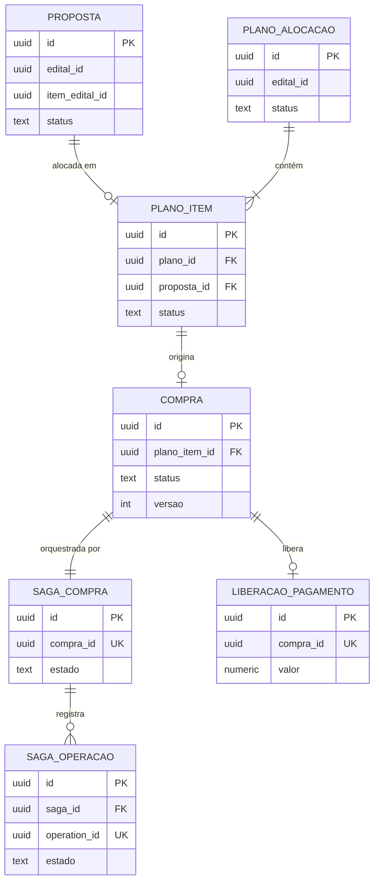
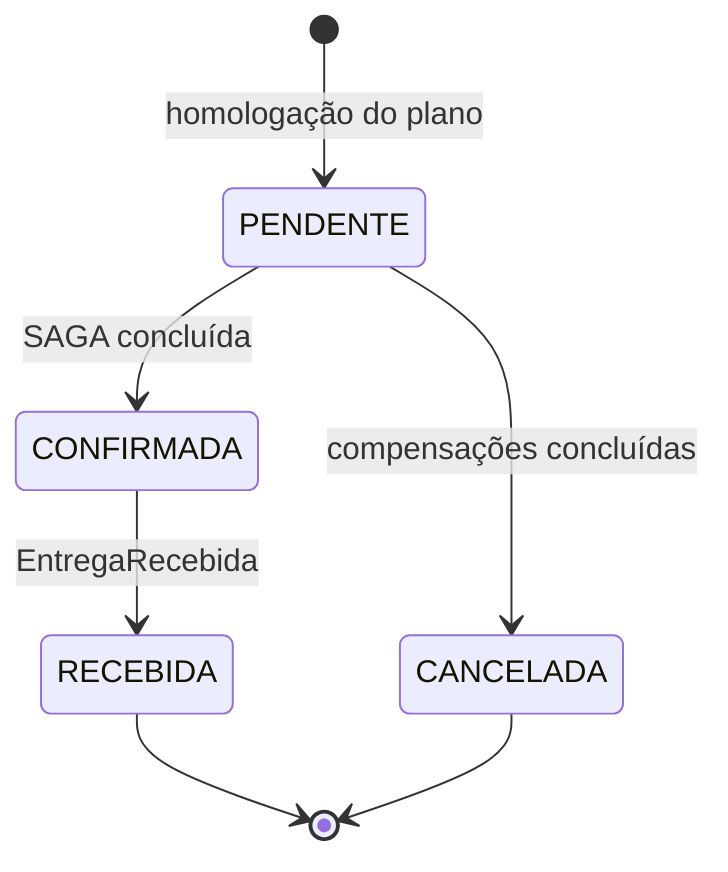
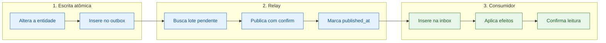
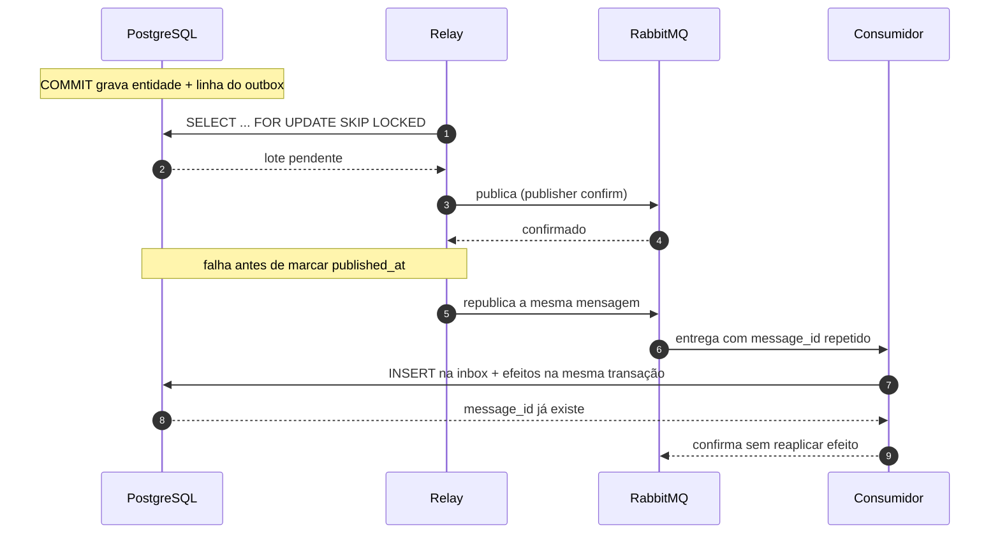

# Dados, consistência e concorrência

> Entregas **P1-03** (entidades, referências externas, snapshots e instâncias) e **P1-04** (concorrência nas reservas, consistência eventual e pontos de dual write).
> O padrão outbox é detalhado em [`02-dados-outbox.md`](./02-dados-outbox.md). Decisão de banco registrada em [`ADR 0002`](../adr/0002-postgresql-por-servico.md).

## 1. Princípios

1. **Um banco por serviço.** Quatro instâncias PostgreSQL independentes. Quatro *schemas* em uma única instância **não** atendem ao enunciado.
2. **Um dono por dado.** Cada tabela pertence a exatamente um serviço; nenhum outro serviço lê ou escreve nela.
3. **Sem chave estrangeira entre bancos.** IDs de outros serviços são referências externas validadas por contrato, não por constraint.
4. **Cópia é snapshot, não verdade.** Toda cópia de dado alheio é imutável, marcada com `snapshotAt` e não decide saldo, permissão ou pagamento.
5. **Transação local nunca atravessa serviço.** Consistência entre serviços é obtida pela SAGA e por eventos, não por transação distribuída.

## 2. Instâncias, acesso e credenciais

| Serviço | Instância | Banco | Usuário | Privilégios |
|---|---|---|---|---|
| Editais | `editais-db` | `editais` | `app_editais` | Apenas no próprio banco |
| Ofertas | `ofertas-db` | `ofertas` | `app_ofertas` | Apenas no próprio banco |
| Compras | `compras-db` | `compras` | `app_compras` | Apenas no próprio banco |
| Entregas | `entregas-db` | `entregas` | `app_entregas` | Apenas no próprio banco |

- A conexão é recebida por variável de ambiente (`DATABASE_URL`) e **nenhuma credencial é versionada**; na Parte 3 isso vira `Secret` do Kubernetes.
- Nenhum serviço usa superusuário. Cada usuário só enxerga o próprio banco.
- Migrações são versionadas **dentro de cada serviço** e aplicadas no início controlado (não automático em todos os pods ao mesmo tempo).
- Pool de conexões com limite explícito por instância, para que um serviço não consuma as conexões dos demais.

**Por que PostgreSQL em todos:** transações ACID para reservas e outbox, constraint de saldo não negativo, `jsonb` para critérios do edital e operação uniforme. Diversidade de banco por serviço não traria benefício neste domínio e multiplicaria o custo de operação — ver ADR 0002.

## 3. Modelo de dados por serviço

Os esquemas abaixo são o **modelo conceitual** acordado entre as frentes; nomes de tabela e coluna são canônicos e mudam só por PR na base comum.

### 3.1 Editais

| Tabela | Campos principais | Regras |
|---|---|---|
| `prefeitura` | `id`, `nome`, `cnpj` (único), `criado_em` | — |
| `escola` | `id`, `prefeitura_id`, `nome`, `endereco`, `ativo` | `prefeitura_id` é FK **interna** |
| `edital` | `id`, `prefeitura_id`, `titulo`, `status`, `prazo_entrega`, `criterios`, `versao` | `status`: `RASCUNHO`, `PUBLICADO`, `ENCERRADO` |
| `item_edital` | `id`, `edital_id`, `produto`, `unidade`, `quantidade`, `saldo`, `versao` | `CHECK (saldo >= 0)` e `CHECK (saldo <= quantidade)` |
| `alocacao_demanda` | `id`, `item_edital_id`, `compra_id` (único), `operation_id` (único), `quantidade`, `criado_em` | Garante uma reserva por compra/operação |

`criterios` guarda a lista ordenada e parametrizável de critérios do edital — é **dado**, não código. O algoritmo que a interpreta é `Strategy` (ver [`01-servicos.md`](./01-servicos.md)).

### 3.2 Ofertas

| Tabela | Campos principais | Regras |
|---|---|---|
| `produtor` | `id`, `nome`, `documento` (único), `email`, `ativo` | — |
| `oferta` | `id`, `produtor_id`, `produto`, `unidade`, `quantidade_disponivel`, `ativa`, `versao` | `CHECK (quantidade_disponivel >= 0)` |
| `reserva_oferta` | `id`, `oferta_id`, `compra_id`, `operation_id`, `quantidade`, `status`, `criado_em` | `UNIQUE (compra_id, operation_id)`; `status`: `ATIVA`, `LIBERADA` |

### 3.3 Compras

| Tabela | Campos principais | Regras |
|---|---|---|
| `proposta` | `id`, `edital_id`, `item_edital_id`, `produtor_id`, `oferta_id`, `quantidade`, `status`, `chave_idempotencia`, snapshots, `snapshot_at` | `UNIQUE (chave_idempotencia)`; `status`: `ENVIADA`, `ALOCADA`, `RETIRADA`, `REJEITADA` |
| `plano_alocacao` | `id`, `edital_id`, `gestor_id`, `criterios_snapshot`, `status`, `versao` | `status`: `SUGERIDO`, `HOMOLOGADO` |
| `plano_item` | `id`, `plano_id`, `proposta_id`, `quantidade`, `status`, `compra_id` | `status`: `PENDENTE`, `HOMOLOGADO`, `EXCLUIDO` |
| `compra` | `id`, `plano_item_id`, `proposta_id`, `edital_id`, `item_edital_id`, `produtor_id`, `escola_id`, snapshots, `status`, `versao` | `status`: `PENDENTE`, `CONFIRMADA`, `RECEBIDA`, `CANCELADA` |
| `saga_compra` | `id`, `compra_id` (único), `estado`, `passo_atual`, `proximo_comando`, `passos_concluidos`, `motivo_falha`, `tentativas`, `prazo_resposta`, `versao` | `estado`: `EM_ANDAMENTO`, `COMPENSANDO`, `CONCLUIDA`, `CANCELADA` |
| `saga_operacao` | `id`, `saga_id`, `operation_id` (único), `comando`, `estado`, `resposta`, `atualizado_em` | Registra o resultado por operação, inclusive `DESCONHECIDO` |
| `liberacao_pagamento` | `id`, `compra_id` (**único**), `valor`, `moeda`, `liberado_em` | `UNIQUE (compra_id)` impede liberação dupla |

`saga_operacao` é o que torna possível responder a timeout e resposta tardia sem duplicar efeito: o estado do comando é persistido por `operation_id`.

### 3.4 Entregas

| Tabela | Campos principais | Regras |
|---|---|---|
| `capacidade_logistica` | `id`, `escola_id`, `janela_inicio`, `janela_fim`, `capacidade_kg`, `reservado_kg`, `versao` | `CHECK (reservado_kg >= 0 AND reservado_kg <= capacidade_kg)` |
| `agendamento` | `id`, `compra_id` (único), `operation_id` (único), `escola_id`, `janela_inicio`, `janela_fim`, `status` | `status`: `ATIVO`, `CANCELADO` |
| `entrega` | `id`, `compra_id` (único), `escola_id`, `agendamento_id`, `status`, `recebido_em`, `recebido_por` | `status`: `AGENDADA`, `RECEBIDA`, `CANCELADA` |
| `confirmacao_recebimento` | `id`, `entrega_id` (único), `confirmado_por`, `confirmado_em` | Uma confirmação por entrega |

### 3.5 Diagrama do agregado Compras



O diagrama mostra as relações e os campos que identificam cada entidade. Os demais campos estão nas tabelas das seções 3.1 a 3.4. `edital_id`, `item_edital_id`, `produtor_id` e `oferta_id` são **referências externas**: não existe FK entre bancos.

### 3.6 Estados da Compra



A Compra permanece `PENDENTE` durante a execução **e** durante a compensação. Os estados internos da SAGA (`EM_ANDAMENTO`, `COMPENSANDO`, `CONCLUIDA`, `CANCELADA`) são da frente de SAGA e não substituem este ciclo.

## 4. Referências externas e snapshots

| Snapshot | Guardado em | Campos | Por quê |
|---|---|---|---|
| Edital e item | `proposta`, `compra` | `edital_id`, `item_edital_id`, `produto`, `unidade` | Preservar o que foi proposto mesmo se o edital for editado |
| Escola e prefeitura | `compra` | `escola_id`, `escola_nome` | Emitir a compra sem consultar Editais em toda leitura |
| Produtor | `proposta`, `compra` | `produtor_id`, `produtor_nome` | Idem para o lado da oferta |
| Critérios do edital | `plano_alocacao` | `criterios_snapshot` | O plano homologado precisa ser reproduzível mesmo se o edital mudar |

Regras dos snapshots:

- Sempre imutáveis e acompanhados de `snapshot_at`.
- Nunca usados para autorização, cálculo de saldo ou liberação de pagamento.
- A divergência entre snapshot e origem é aceitável e não exige reprocessamento; a próxima operação lê o dado atual.

## 5. Concorrência nas reservas

O risco é o **excesso de alocação**: duas compras concorrentes consumindo o mesmo saldo de item ou a mesma produção.

### 5.1 Estratégia escolhida: `UPDATE` condicional

- Cada operação de reserva é **uma única instrução**, executada na instância do dono do dado:

```sql
-- Editais
UPDATE item_edital
   SET saldo = saldo - :qtd,
       versao = versao + 1
 WHERE id = :item_edital_id
   AND saldo >= :qtd;
```

- `1 linha afetada` → reserva concedida. `0 linhas` → saldo insuficiente, e o serviço publica a rejeição (`AlocacaoDemandaRejeitada`).
- Mesmo padrão em Ofertas (`quantidade_disponivel >= :qtd`) e Entregas (`capacidade_kg - reservado_kg >= :qtd`).

**Por que funciona:** em PostgreSQL, `READ COMMITTED` com `UPDATE` adquire bloqueio de linha. Quando há disputa, a segunda transação espera, e a condição `saldo >= :qtd` é **reavaliada sobre a versão já atualizada**. Resultado: não existe janela em que duas reservas leiam o mesmo saldo e ambas confirmem.

### 5.2 Idempotência da operação

- `alocacao_demanda (compra_id, operation_id)`, `reserva_oferta (compra_id, operation_id)` e `agendamento (compra_id, operation_id)` têm unicidade.
- Reentrega do mesmo comando devolve **a resposta original** (sucesso ou rejeição), sem aplicar o desconto de novo.
- A compensação (`LiberarDemanda`, `LiberarOferta`, `CancelarAgendamento`) também é idempotente: só devolve saldo quando a reserva está `ATIVA`.

### 5.3 Controle otimista para edição

- `edital.versao`, `plano_alocacao.versao`, `compra.versao` e `capacidade_logistica.versao` existem para detectar edição concorrente.
- Ajuste de plano e edição de capacidade usam a versão lida; conflito devolve `409` e o cliente recarrega (contrato HTTP na frente P2).
- Reservas **não** usam controle otimista com retry cego: a instrução condicional já é atômica e o retry cego poderia duplicar tentativa de negócio.

## 6. Consistência eventual e dual write

### 6.1 Pontos de consistência eventual

| Ponto | O que pode ficar defasado | Defasagem aceita | Decisão crítica? |
|---|---|---|---|
| Projeção `AcompanhamentoCompra` | Status, etapa da SAGA, entrega e pagamento na leitura | Até 5 s em operação normal (meta, ainda não medida) | Não — a escrita sempre lê o modelo de escrita |
| Snapshots de proposta e compra | Nome de escola, produtor e produto já emitidos | Indefinida por projeto (histórico proposital) | Não |
| Compra vista pelo BFF durante a SAGA | Compra `PENDENTE` com etapas já executadas internamente | Segundos | Não |
| Homologação → criação das compras | Plano `HOMOLOGADO` antes das compras existirem | `202` + consulta ao status por item | Não |
| Entregas → Compras | Compra ainda `CONFIRMADA` por instantes após o recebimento | Segundos | Não — a transição é idempotente |
| Saldo exibido no painel | Saldo do item antes de reservas em andamento | Segundos | Não — o número exibido é indicativo; a reserva decide |

Regra geral: **defasagem é aceitável em leitura, nunca em decisão**. Saldo, capacidade, autorização e liberação de pagamento são sempre resolvidos no serviço dono, dentro de transação local.

### 6.2 Onde existe dual write

| Operação | Dois efeitos possíveis | Risco | Tratamento |
|---|---|---|---|
| Confirmar entidade + publicar evento | Banco e broker | Divergência se falhar entre os dois | **Eliminado** pelo outbox transacional (seção 7) |
| Atualização da projeção | Escrita de Compras e tabela de leitura | Projeção atrasada ou fora de ordem | Outbox + inbox + `versao` monotônica (detalhado em `03-cqrs.md`) |
| Criação de compras na homologação | Uma compra e uma SAGA por item | Item criado sem SAGA | Mesma transação local: `plano_item`, `compra`, `saga_compra` e linha do outbox commitam juntos |
| Cache de resposta do LLM (Parte 4) | Resposta e cache | Cache obsoleto após mudança de dado | Invalidação por evento e TTL; não é escopo da Parte 2 |
| Chamada HTTP entre serviços | Efeito local + chamada remota | Serviço remoto aplica e o local falha | Chamada síncrona usada só para **consulta**; qualquer efeito de negócio é comando assíncrono |

**Em resumo:** o dual write estrutural (banco + broker) foi eliminado pelo outbox. O que resta é defasagem de leitura e cache, tratada por idempotência e versão — não por transação distribuída. Não há 2PC em nenhum fluxo.

## 7. Outbox transacional

### 7.1 Problema que resolve

Publicar direto no broker depois do `COMMIT` cria uma janela: se o processo cair entre as duas ações, o banco tem o dado novo e os consumidores nunca saberão. O outbox elimina a janela porque a mensagem é gravada **na mesma transação** que a entidade.

```
BEGIN
  UPDATE compra SET status = 'CONFIRMADA' WHERE id = :id AND status = 'PENDENTE';
  INSERT INTO outbox (message_id, type, aggregate_id, aggregate_version, payload, ...) VALUES (...);
COMMIT   -- os dois efeitos existem ou nenhum existe
```

### 7.2 Estrutura da tabela

| Coluna | Tipo | Função |
|---|---|---|
| `id` | `bigserial` | Ordem de inserção local |
| `message_id` | `uuid` único | Chave de deduplicação no consumidor |
| `type` | `text` | Nome canônico do comando/evento (`ReservarOferta`, `OfertaReservada`) |
| `schema_version` | `int` | Evolução do payload |
| `aggregate_id` | `uuid` | Agregado de origem |
| `aggregate_version` | `int` | Ordena as mensagens do mesmo agregado |
| `payload` | `jsonb` | Corpo da mensagem |
| `correlation_id` / `causation_id` | `uuid` | Rastreabilidade da cadeia |
| `occurred_at` | `timestamptz` | Momento do fato de negócio |
| `published_at` | `timestamptz` nulo | Quando o relay confirmou a publicação |
| `attempts` | `int` | Tentativas de publicação |
| `next_attempt_at` | `timestamptz` | Controle de backoff |
| `status` | `text` | `PENDENTE`, `PUBLICADA`, `FALHA` |

Índices: `(status, next_attempt_at)` para o relay e `(aggregate_id, aggregate_version)` para ordenação.

### 7.3 Relay

- Processo **dentro de cada serviço**, sem banco próprio.
- Ciclo: busca lote de 100 linhas `PENDENTE` com `FOR UPDATE SKIP LOCKED`, publica com *publisher confirm* do broker, marca `published_at` e `status = PUBLICADA` em uma transação curta.
- Intervalo de 500 ms; o `SKIP LOCKED` permite mais de um relay concorrente sem reprocessar as mesmas linhas.
- **Ordem:** garantida por agregado (`aggregate_version`), usando uma fila com concorrência 1 por consumidor. Não se presume ordem global entre agregados diferentes — o enunciado da base já alerta para isso.
- **Falha ao publicar:** incrementa `attempts`, calcula `next_attempt_at` com backoff exponencial e *jitter*, mantém `PENDENTE`. Depois do limite, `FALHA` e alerta — sem descarte silencioso.
- **Alternativa descartada nesta fase:** CDC com Debezium. Funciona, mas adiciona um conector e uma infraestrutura de leitura do WAL para um volume que o *polling* resolve; pode substituir o relay sem mudar contrato, porque a tabela e o envelope permanecem.

### 7.3.1 Caminho de uma mensagem



### 7.4 Janelas de falha

| # | Falha | Estado resultante | Consequência | Mitigação |
|---|---|---|---|---|
| 1 | Serviço cai após o `COMMIT`, antes de publicar | Entidade gravada, outbox `PENDENTE` | Evento atrasado | Relay retoma na próxima varredura |
| 2 | Publica e cai antes de marcar `PUBLICADA` | Outbox `PENDENTE`, mensagem já no broker | Mensagem duplicada | Inbox do consumidor deduplica por `message_id` |
| 3 | Broker indisponível | Outbox acumula `PENDENTE` | Atraso crescente | Backoff + métrica de *lag* + alerta |
| 4 | Consumidor processa e cai antes do `COMMIT` | Nada aplicado | Reentrega | Reprocessa do zero (inbox e efeitos na mesma transação) |
| 5 | Consumidor faz `COMMIT` e cai antes do *ack* | Efeito aplicado | Reentrega | Inbox encontra `message_id` e ignora |
| 6 | Mensagem envenenada (payload inválido) | `attempts` esgota | Bloqueio de fila se fosse retry infinito | Vai para DLQ e exige intervenção |



A mensagem é entregue **duas vezes** e o efeito acontece **uma vez**: é esse o comportamento que precisamos garantir.

**Conclusão:** o sistema é *at-least-once*. A garantia de efeito único vem da **inbox + unicidade de negócio** (`compra_id`/`operation_id`), não da entrega.

## 8. Inbox e idempotência do consumidor

| Coluna | Função |
|---|---|
| `message_id` (chave primária) | Marca de consumo |
| `type` | Tipo processado |
| `consumido_em` | Momento do processamento |

Regra de ouro: o `INSERT` na inbox e os efeitos de negócio acontecem **na mesma transação**. Se a mensagem já existe, a transação inteira é descartada e o *ack* é confirmado.

A unicidade de negócio é a segunda barreira: mesmo que a inbox fosse limpa por retenção, `alocacao_demanda (compra_id, operation_id)`, `liberacao_pagamento (compra_id)` e `reserva_oferta (compra_id, operation_id)` impedem o efeito duplicado.

## 9. Retry, DLQ e observabilidade

### 9.1 Retry do relay (publicação)

- 5 tentativas com backoff exponencial (1 s, 2 s, 4 s, 8 s, 16 s) e *jitter* de até 20%.
- Falha em qualquer tentativa mantém a linha `PENDENTE`; nada é descartado por erro de publicação.

### 9.2 Retry do consumidor (reentrega)

O consumidor só confirma a leitura **depois** do `COMMIT`. Sem confirmação, o broker reentrega — e a inbox garante que o efeito não duplica.

| Situação | Classificação | Ação |
|---|---|---|
| Broker, banco ou rede indisponível; `timeout`; deadlock ou falha de serialização | Transitória | Não confirmar; reentrega com backoff |
| Payload inválido, `type` desconhecido, `schemaVersion` não suportada | Permanente | Não reentregar; registrar e enviar à DLQ |
| Rejeição de negócio (`OfertaReservada` negativa, saldo insuficiente) | **Não é falha técnica** | Confirmar a leitura e tratar como resposta de negócio |

Regras:

- **Mesmo backoff do relay:** 5 tentativas (1 s, 2 s, 4 s, 8 s, 16 s) com *jitter*. A espera acontece em **fila de retry com TTL**, não bloqueando a fila principal.
- **Nada de commit parcial:** inbox e efeitos na mesma transação; qualquer erro descarta a transação inteira.
- **Sem retry infinito:** após a 5ª tentativa a mensagem vai para a DLQ — mensagem envenenada não pode travar a fila.
- **Timeout de processamento** por mensagem; estouro equivalente a erro transitório.
- **Retry não é compensação:** repetir `ReservarOferta` é medida técnica; desfazer é `LiberarOferta`, decidido pela SAGA. Confundir os dois gera efeito de negócio indevido.

### 9.3 DLQ

`<servico>.<tipo>.dlq`, com o payload original, o erro e o número de tentativas. Reprocessamento é manual e auditável.

### 9.4 Observabilidade e retenção

- **Métricas mínimas:** `outbox_pendentes`, `outbox_lag_segundos` (agora − `occurred_at` mais antigo pendente), `outbox_publicadas_total`, `outbox_falhas_total`, `consumo_retentativas_total`, `consumo_dlq_total`, `dlq_profundidade`.
- **Logs:** `correlation_id` em toda linha, permitindo seguir uma compra da homologação até a projeção.
- **Retenção:** linhas `PUBLICADA` são mantidas por 7 dias (auditoria) e depois removidas por rotina diária; a inbox mantém 30 dias.

## 10. Padrões aplicados e critérios de aceite

| Padrão | Onde | Papel |
|---|---|---|
| **Transactional Outbox** | Todos os serviços | Elimina o dual write banco/broker |
| **Idempotent Consumer (Inbox)** | Todos os consumidores | Torna a reentrega inofensiva |
| **Repository** | Acesso a cada agregado | Isola SQL do domínio |
| **Unit of Work** | Caso de uso | Garante entidade + outbox na mesma transação |
| **Retry com backoff** | Relay e consumidores | Absorve indisponibilidade transitória sem perder mensagem |
| **Dead Letter Channel** | Fila de mensagens mortas | Evita bloqueio por mensagem envenenada |

**Aceite da frente (P1-05):** é possível responder, sem ambiguidade, (a) o que acontece se o relay cair com linhas pendentes, (b) o que acontece se ele publicar e falhar antes de marcar, (c) por que a reentrega não duplica reserva nem liberação de pagamento, (d) onde a mensagem vai quando esgota as tentativas e (e) quais erros são retentados, quais são permanentes e qual rejeição é de negócio.
