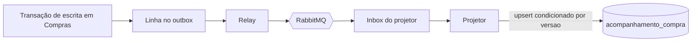

# CQRS em Compras

> Entrega **P1-06**. Complementa [`02-dados-outbox.md`](./02-dados-outbox.md) (entrega dos eventos) e [`01-servicos.md`](./01-servicos.md) (fronteiras).
> Decisão registrada em [`ADR 0003`](../adr/0003-cqrs-em-compras.md).

## 1. Por que Compras se beneficia da separação

Com **um banco por serviço**, não existe `JOIN` entre bancos. O acompanhamento de uma compra precisa combinar:

- de **Compras**: status da compra, etapa da SAGA e liberação de pagamento;
- de **Editais**: título do edital e escola de destino;
- de **Ofertas**: nome do produtor e produto;
- de **Entregas**: status e data do agendamento, e o recebimento.

Sem projeção, cada consulta do painel exigiria **quatro chamadas** mais a reconstrução do progresso da SAGA no cliente — chamadas em série, sujeitas à indisponibilidade de qualquer serviço, com payload diferente por BFF.

O CQRS resolve isso com **um modelo de escrita normalizado** (fonte de verdade) e **um modelo de leitura desnormalizado** (`AcompanhamentoCompra`), atualizado por eventos. A leitura passa a ser uma única consulta local.

**Por que só em Compras:** é o único serviço cujo dado de leitura é uma composição de quatro serviços e cuja escrita tem estado de processo (a SAGA). Em Editais e Ofertas, a leitura é praticamente a própria tabela; aplicar CQRS ali seria complexidade sem benefício.

## 2. Modelo de escrita

Fonte de verdade — normalizado, transacional, sem campos derivados:

| Tabela | Papel |
|---|---|
| `proposta` | Intenção do produtor, com snapshots de validação |
| `plano_alocacao` / `plano_item` | Sugestão de alocação e homologação |
| `compra` | Agregado do compromisso comercial |
| `saga_compra` / `saga_operacao` | Progresso e resultado por operação |
| `liberacao_pagamento` | Estado de pagamento (`UNIQUE compra_id`) |

**Invariantes do lado da escrita** (nunca validados na leitura): transição de estado da compra, unicidade de liberação de pagamento, reserva única por `operation_id`.

## 3. Modelo de leitura

Tabela `acompanhamento_compra`, na mesma instância de Compras (um banco adicional não é obrigatório):

| Coluna | Origem | Observação |
|---|---|---|
| `compra_id` (PK) | Compra | Chave da projeção |
| `edital_id`, `edital_titulo` | Snapshot da proposta | Imutável |
| `produtor_id`, `produtor_nome` | Snapshot da proposta | Imutável |
| `escola_id`, `escola_nome` | Snapshot da compra | Imutável |
| `produto`, `quantidade`, `unidade` | Snapshot da compra | `quantidade` decimal + unidade explícita |
| `status` | Compra | `PENDENTE`, `CONFIRMADA`, `RECEBIDA`, `CANCELADA` |
| `etapa_saga` | `saga_compra` | `EM_ANDAMENTO`, `COMPENSANDO`, `CONCLUIDA`, `CANCELADA` |
| `entrega_status`, `entrega_data` | Resposta de `EntregaAgendada` / `EntregaRecebida` | — |
| `pagamento_status` | `liberacao_pagamento` | `AGUARDANDO_RECEBIMENTO` / `LIBERADO` |
| `updated_at` | Projetor | Momento da aplicação |
| `versao` | Compra / SAGA | Controle de ordem |

Índices de leitura: `(status)`, `(escola_id)`, `(produtor_id)`, `(updated_at)`.

**Separação física:** tabelas de leitura próprias (`rm_` ou schema `leitura`) na instância de Compras. Isso já garante que o modelo de leitura possa ser reconstruído sem tocar nas tabelas de escrita.

## 4. Como o modelo de leitura é atualizado

Eventos que alimentam a projeção (nomes canônicos):

| Evento | Atualiza |
|---|---|
| `CompraCriada` | linha inicial com `PENDENTE` e `EM_ANDAMENTO` |
| `SagaProgrediu` | `etapa_saga` |
| `CompraConfirmada` | `status = CONFIRMADA` |
| `CompraCancelada` | `status = CANCELADA` |
| `EntregaAgendada` | `entrega_status`, `entrega_data` |
| `EntregaRecebida` | `status = RECEBIDA`, `entrega_status = RECEBIDA` |
| `LiberacaoPagamentoRegistrada` | `pagamento_status = LIBERADO` |

O projetor é um consumidor comum: grava na inbox e faz o *upsert* na mesma transação. A regra de ordem é **por agregado**: aplica apenas se `evento.aggregate_version > linha.versao`, o que impede uma mensagem antiga de regredir o estado.

## 5. Defasagem aceitável

| Item | Definição |
|---|---|
| Meta | até **5 segundos** entre o `COMMIT` da escrita e a leitura refletindo a mudança, em operação normal no ambiente de teste |
| Situação | **meta de projeto, ainda não medida** — a medição entra na Parte 4 |
| Transparência | a resposta expõe `updated_at`; a interface mostra "atualizando" enquanto o evento não chega e permite nova consulta |
| Limite de negócio | nenhuma decisão (reservar, cancelar, liberar pagamento) é tomada com base na projeção |

Aceitamos 5 s porque o painel é **supervisão**, não operação. Se o volume exigir, o mesmo desenho suporta reduzir o intervalo do relay sem mudar contrato.

## 6. Reconstrução sem replay do broker

Filas convencionais **não retêm** mensagens já consumidas. Portanto a reconstrução **não depende do broker**:

1. Truncar (ou criar uma nova geração de) `acompanhamento_compra`.
2. Ler as tabelas de escrita de Compras: `compra`, `saga_compra`, `liberacao_pagamento` e os snapshots de `proposta`.
3. Reprojetar em lote, na ordem de `versao`, de forma determinística.
4. Republicar o resultado para os BFFs não é necessário — eles consultam a projeção.

Propriedades: a reconstrução é **idempotente** (pode rodar duas vezes), **não altera o modelo de escrita** e pode rodar em paralelo, com *swap* da geração ao final para não expor tabela vazia.

Opcionalmente, os eventos ainda no outbox (`PENDENTE`) são reprocessados depois da reconstrução para cobrir escritas ocorridas durante a janela.

## 7. Idempotência e concorrência do projetor

- Deduplicação por `message_id` na inbox.
- Ordem por `versao` por agregado; evento com versão menor é descartado com registro de métrica (`projecao_evento_obsoleto_total`).
- Múltiplos projetores: partição por `aggregate_id`, garantindo um único consumidor por compra.
- Projeção nunca é atualizada por escrita direta de outro serviço.

## 8. O que o CQRS **não** faz

- Não decide saldo de oferta, saldo de edital ou autorização de pagamento.
- Não substitui a consulta ao serviço dono quando o dado é decisivo.
- Não exige *event sourcing*: o modelo de escrita continua sendo estado atual, não log de eventos.
- Não cria um segundo banco obrigatório — as tabelas de leitura vivem na instância de Compras.

## 9. Alternativas descartadas

| Alternativa | Por que não |
|---|---|
| **Consulta agregada no BFF** (4 chamadas por requisição) | Latência em série, falha em cascata e reconstrução da SAGA no cliente |
| **Projeção em banco separado** | Um banco adicional para uma única projeção; a separação lógica já permite reconstrução |
| **Event sourcing completo** | Exigiria reescrever todo o modelo de escrita; a projeção resolve a leitura sem esse custo |
| **Tabela de leitura materializada por `VIEW`** | `VIEW` não atravessa bancos; manteria o problema original |
| **Cache de resposta no BFF** | Não resolve composição nem ordem; complementa, não substitui |

## 10. Riscos e aceite

| Risco | Mitigação |
|---|---|
| Projeção atrasada além da meta | métrica de *lag* + alerta; interface indica estado desatualizado |
| Evento fora de ordem | `versao` monotônica por agregado |
| Reconstrução durante operação | geração nova + *swap* |
| Divergência entre escrita e leitura | reconstrução determinística a partir da escrita |

**Aceite (P1-06):** (a) escrita e leitura estão separados com tabelas distintas; (b) a justificativa é a composição de quatro serviços, não "moda arquitetural"; (c) a atualização é por evento com outbox/inbox; (d) a defasagem aceitável está declarada como meta; (e) existe caminho de reconstrução que **não** depende do broker.
