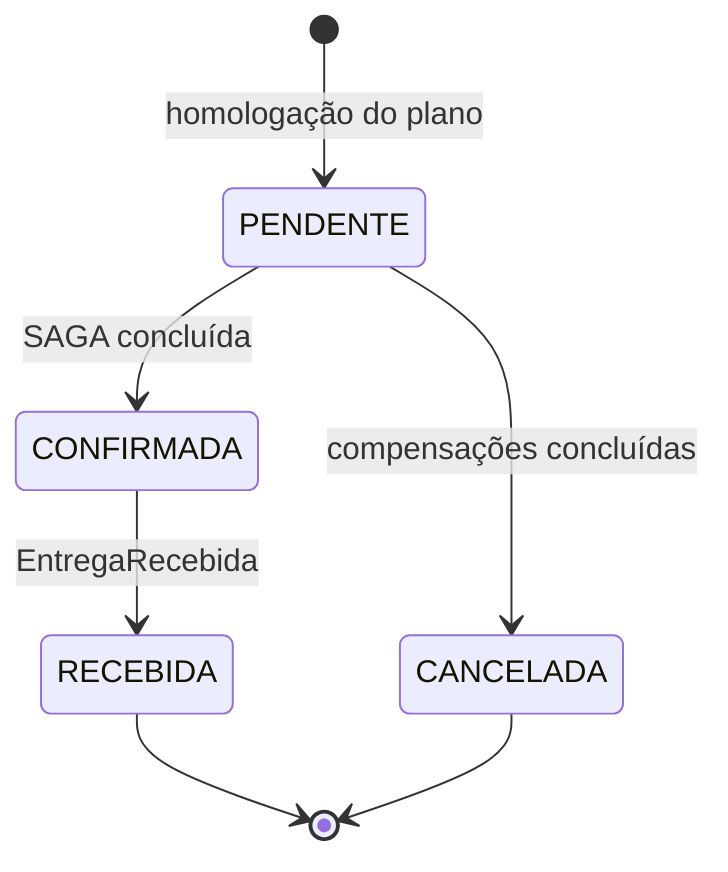
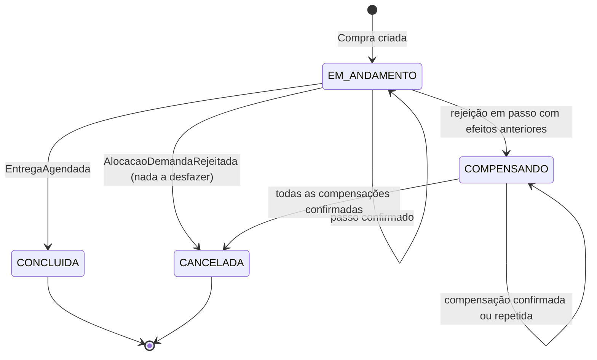
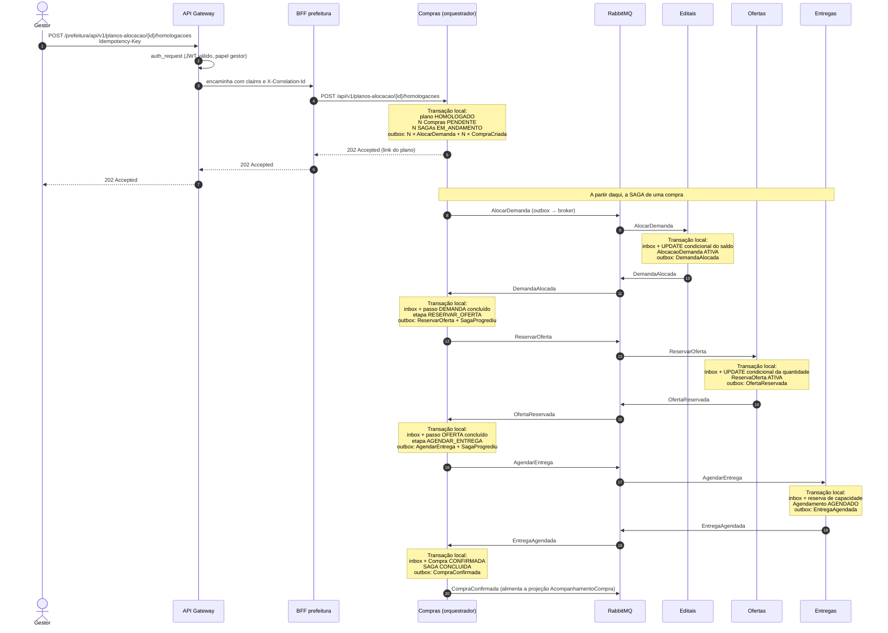
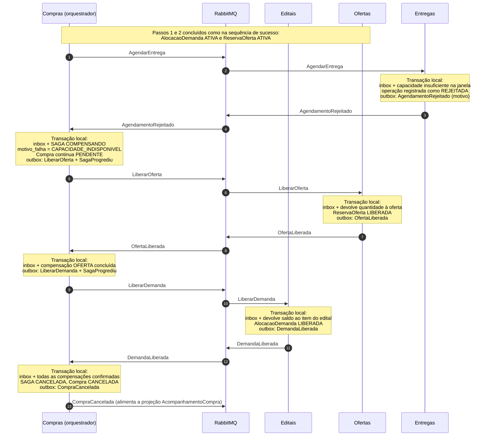

# SAGA: confirmar compra

> Orquestração e estado persistido, sequências de sucesso e de falha, timeouts e compensação incompleta, recebimento e liberação de pagamento. Detalha a seção 7 de [`00-base-comum.md`](./00-base-comum.md).
> Nomes de comandos e eventos seguem [`06-mensagens.md`](./06-mensagens.md). Decisão registrada em [`ADR 0005`](../adr/0005-saga-orquestrada.md).

## 1. Visão geral

Confirmar uma compra exige efeitos em quatro serviços, cada um com seu próprio banco:

| Serviço | Efeito necessário |
|---|---|
| Compras | Registrar a compra e acompanhar seu progresso |
| Editais | Reservar saldo do item do edital, para que duas compras não excedam a demanda |
| Ofertas | Reservar a produção do produtor, sem saldo negativo |
| Entregas | Reservar capacidade logística e agendar a entrega na escola |

Como não existe transação de banco entre serviços, a confirmação é uma **SAGA**: uma sequência de transações locais, cada uma com uma **compensação** que desfaz seu efeito de negócio se um passo posterior falhar. A transação atravessa quatro serviços, acima do mínimo de três exigido.

## 2. Variante escolhida: orquestrada

O serviço **Compras** é o orquestrador. Ele persiste o estado de cada SAGA, envia um comando por vez a cada participante e decide, a partir da resposta, se avança, repete ou compensa.

| Critério | Orquestrada (escolhida) | Coreografada |
|---|---|---|
| Onde o fluxo está definido | Em um único lugar (Compras) | Espalhado nas assinaturas de eventos de cada serviço |
| Estado atual de uma compra | Uma linha em `saga_compra` | Reconstruído a partir de quatro bancos |
| Timeouts | O orquestrador controla o prazo de cada passo | Cada participante precisaria vigiar o anterior |
| Compensações | Disparadas e confirmadas pelo orquestrador, em ordem inversa | Cada serviço reage a eventos de falha; difícil garantir que tudo foi desfeito |
| Incluir ou reordenar passos | Muda apenas o orquestrador | Muda vários participantes |
| Custo | Compras concentra a coordenação | Sem ponto central |

O fluxo tem quatro etapas, compensações em ordem definida e casos de timeout com resultado desconhecido. Nesse cenário, a visibilidade e a auditoria da orquestração pesam mais que a ausência de ponto central da coreografia. Os participantes respondem com eventos, mas **quem decide o próximo passo é sempre o orquestrador**: o uso de eventos não torna a SAGA coreografada.

## 3. Gatilho: 1 plano, N SAGAs

A SAGA começa na homologação do plano de alocação (`POST /api/v1/planos-alocacao/{id}/homologacoes`, papel `gestor`, com `Idempotency-Key`).

1. Compras valida o plano e, **em uma única transação local**, marca o plano como homologado, cria uma Compra `PENDENTE` por item do plano, cria uma linha em `saga_compra` (`EM_ANDAMENTO`) para cada compra e grava no outbox um `AlocarDemanda` por compra.
2. A API responde `202 Accepted` com o link do plano, que expõe o status de cada item.
3. Cada SAGA avança de forma **independente**. A falha de uma não desfaz as demais: o plano pode terminar com itens confirmados e itens cancelados.

Várias SAGAs podem disputar o mesmo item do edital ou a mesma oferta. A sugestão do plano não garante disponibilidade; quem decide é a reserva atômica no serviço dono (`UPDATE` condicional, ver [`02-dados-outbox.md`](02-dados-outbox.md), seção 5).

## 4. Estado persistido

### 4.1 Tabela `saga_compra` (banco de Compras)

| Campo | Descrição |
|---|---|
| `saga_id` | UUID da SAGA; vai em todas as mensagens como `sagaId` |
| `compra_id` | Compra coordenada (1:1) |
| `plano_alocacao_id` | Plano que originou a compra |
| `estado` | `EM_ANDAMENTO`, `COMPENSANDO`, `CONCLUIDA`, `CANCELADA` |
| `etapa_atual` | `ALOCAR_DEMANDA`, `RESERVAR_OFERTA`, `AGENDAR_ENTREGA`, `CONCLUIR` ou a compensação em curso |
| `passos_concluidos` | Quais efeitos já foram confirmados (`DEMANDA`, `OFERTA`, `AGENDAMENTO`); define o que compensar |
| `motivo_falha` | Código da rejeição ou do timeout que iniciou a compensação |
| `tentativas` | Contador de reenvios do comando atual |
| `prazo_resposta` | Instante limite para a resposta do passo atual (timeout) |
| `versao` | Controle de concorrência e ordem dos eventos publicados |
| `criada_em`, `atualizada_em` | Auditoria |

### 4.2 Tabela `saga_passo` (histórico)

Uma linha por comando enviado: `saga_id`, `operation_id`, `tipo_comando`, `participante`, `enviado_em`, `respondido_em`, `resultado` (`SUCESSO`, `REJEITADO`, `PENDENTE`). Serve para auditoria, para reconhecer respostas duplicadas ou tardias e para mostrar o progresso na projeção `AcompanhamentoCompra`.

### 4.3 `operationId`

Cada comando de negócio e cada compensação recebem um `operationId` gerado pelo orquestrador **antes** do primeiro envio e reaproveitado em todo reenvio. Os participantes garantem unicidade por `(compraId, operationId)` e, se receberem o mesmo comando de novo, devolvem a resposta original sem repetir o efeito.

### 4.4 Regra de gravação

Toda transição de estado acontece em **uma transação local** de Compras que grava, juntas:

- a resposta recebida na inbox (deduplicação);
- a nova linha de estado em `saga_compra` e o registro em `saga_passo`;
- o próximo comando e o evento de transição (para a projeção) no outbox.

Se o processo cair antes do `COMMIT`, nada foi aplicado e a mensagem é reentregue. Se cair depois, o relay publica o que ficou no outbox. Após reinício, o orquestrador continua do estado persistido; não há estado só em memória.

## 5. Estados

### 5.1 Compra

A Compra permanece `PENDENTE` durante toda a execução **e** durante a compensação. Ela só passa a `CANCELADA` depois que todos os efeitos conhecidos foram desfeitos.

### 5.2 SAGA

### 5.3 Tabela de transições

| Estado SAGA | Etapa | Mensagem recebida | Ação do orquestrador | Novo estado SAGA | Compra |
|---|---|---|---|---|---|
| `EM_ANDAMENTO` | `ALOCAR_DEMANDA` | `DemandaAlocada` | Envia `ReservarOferta` | `EM_ANDAMENTO` | `PENDENTE` |
| `EM_ANDAMENTO` | `ALOCAR_DEMANDA` | `AlocacaoDemandaRejeitada` | Nada a desfazer; encerra | `CANCELADA` | `CANCELADA` |
| `EM_ANDAMENTO` | `RESERVAR_OFERTA` | `OfertaReservada` | Envia `AgendarEntrega` | `EM_ANDAMENTO` | `PENDENTE` |
| `EM_ANDAMENTO` | `RESERVAR_OFERTA` | `ReservaOfertaRejeitada` | Envia `LiberarDemanda` | `COMPENSANDO` | `PENDENTE` |
| `EM_ANDAMENTO` | `AGENDAR_ENTREGA` | `EntregaAgendada` | Conclui; publica `CompraConfirmada` | `CONCLUIDA` | `CONFIRMADA` |
| `EM_ANDAMENTO` | `AGENDAR_ENTREGA` | `AgendamentoRejeitado` | Envia `LiberarOferta` | `COMPENSANDO` | `PENDENTE` |
| `COMPENSANDO` | `LIBERAR_OFERTA` | `OfertaLiberada` | Envia `LiberarDemanda` | `COMPENSANDO` | `PENDENTE` |
| `COMPENSANDO` | `LIBERAR_DEMANDA` | `DemandaLiberada` | Encerra; publica `CompraCancelada` | `CANCELADA` | `CANCELADA` |
| qualquer | qualquer | timeout do passo | Reenvia o mesmo comando com o mesmo `operationId` (seção 9) | inalterado | inalterado |
| `CONCLUIDA` ou `CANCELADA` | — | resposta duplicada | Descartada pela inbox | inalterado | inalterado |

## 6. Passos e compensações

| Passo | Participante | Comando | Efeito local | Sucesso | Rejeição | Compensação | Resposta da compensação |
|---|---|---|---|---|---|---|---|
| 0 | Compras | (interno) | Compra `PENDENTE`, SAGA `EM_ANDAMENTO`, `AlocarDemanda` no outbox | — | — | Registrar Compra `CANCELADA` após as compensações | — |
| 1 | Editais | `AlocarDemanda` | `UPDATE` condicional do saldo do item; cria `AlocacaoDemanda` `ATIVA` | `DemandaAlocada` | `AlocacaoDemandaRejeitada` | `LiberarDemanda` | `DemandaLiberada` |
| 2 | Ofertas | `ReservarOferta` | `UPDATE` condicional da quantidade disponível; cria `ReservaOferta` `ATIVA` | `OfertaReservada` | `ReservaOfertaRejeitada` | `LiberarOferta` | `OfertaLiberada` |
| 3 | Entregas | `AgendarEntrega` | Reserva capacidade na janela; cria `Agendamento` `AGENDADO` | `EntregaAgendada` | `AgendamentoRejeitado` | `CancelarAgendamento` | `AgendamentoCancelado` |
| 4 | Compras | (interno) | Compra `CONFIRMADA`, SAGA `CONCLUIDA`, `CompraConfirmada` no outbox | — | — | Sem compensação: é o último passo. Cancelar depois disso é outro processo de negócio | — |

**Por que o passo 3 tem compensação, se é o último participante:** `CancelarAgendamento` não é usado no caminho de rejeição do próprio agendamento, mas é necessário quando o resultado do agendamento é desconhecido (timeout) e a SAGA acaba compensando, ou quando uma resposta `EntregaAgendada` chega depois de a SAGA ter decidido cancelar (seção 9).

**Por que esta ordem:** Editais primeiro, porque o saldo da demanda é o recurso mais disputado (várias propostas para o mesmo item) e sua rejeição não deixa nada a desfazer. Ofertas em seguida, porque só faz sentido reservar produção para demanda garantida. Entregas por último, porque o agendamento depende de quantidade e produtor já confirmados.

**Propriedades das compensações:**

- São **operações de negócio**, não rollback: devolvem saldo e registram a liberação, preservando o histórico.
- São **idempotentes**: só devolvem saldo se a reserva estiver `ATIVA`; repetidas, respondem com o mesmo resultado.
- **Não podem ser rejeitadas por regra de negócio**: liberar uma reserva existente sempre é permitido. Se a reserva não existir (o comando original nunca chegou), a compensação registra a operação como cancelada e responde com sucesso.
- Executam em **ordem inversa** aos passos confirmados, usando `passos_concluidos`.

## 7. Sequência de sucesso

O diagrama parte da homologação feita pelo gestor no portal e acompanha **uma** das N SAGAs criadas. As demais seguem o mesmo fluxo, em paralelo e de forma independente.

Para legibilidade, "outbox → broker" representa a linha gravada no outbox na transação local e publicada depois pelo relay no RabbitMQ; cada consumidor grava a mensagem na inbox na mesma transação de seus efeitos (ver [`02-dados-outbox.md`](./02-dados-outbox.md)).

**Pontos de leitura do diagrama:**

- A resposta HTTP ao gestor é `202` (mensagens 5 a 7): a homologação só **inicia** as SAGAs. O progresso é consultado depois em `GET /planos-alocacao/{id}` ou no acompanhamento de cada compra.
- Nenhuma transação atravessa serviços: cada `Note` é uma transação local em um único banco.
- Todo efeito local e a mensagem seguinte são gravados juntos (entidade + outbox), o que elimina o dual write.
- Os eventos `CompraCriada`, `SagaProgrediu` e `CompraConfirmada` atualizam a projeção de leitura `AcompanhamentoCompra` (ver [`03-cqrs.md`](./03-cqrs.md)); o BFF mostra a compra como `PENDENTE` até a confirmação chegar.

## 8. Sequência de falha: agendamento rejeitado

Cenário: demanda e oferta já foram reservadas, mas Entregas não tem capacidade logística na janela de entrega da escola. É o cenário mais completo, porque exige desfazer **dois** efeitos já confirmados, em ordem inversa.

**Pontos de leitura do diagrama:**

- Não há `CancelarAgendamento`: a rejeição foi registrada por Entregas sem criar agendamento, então não há efeito a desfazer nesse serviço.
- A Compra só vira `CANCELADA` na última transação, **depois** de `DemandaLiberada`. Enquanto houver reserva conhecida não desfeita, ela permanece `PENDENTE` e a SAGA em `COMPENSANDO`.
- O saldo devolvido ao item do edital fica disponível para outras compras do mesmo plano ou para um novo plano de alocação.

### 8.1 Outras rejeições de negócio

| Falha | Momento | Efeitos já confirmados | Compensações | Resultado |
|---|---|---|---|---|
| Demanda indisponível | `AlocacaoDemandaRejeitada` no passo 1 | Nenhum | Nenhuma | SAGA e Compra `CANCELADA` imediatamente |
| Oferta indisponível | `ReservaOfertaRejeitada` no passo 2 | Demanda | `LiberarDemanda` → `DemandaLiberada` | SAGA e Compra `CANCELADA` após a liberação |
| Agendamento rejeitado | `AgendamentoRejeitado` no passo 3 | Demanda e oferta | `LiberarOferta` → `OfertaLiberada`, depois `LiberarDemanda` → `DemandaLiberada` | SAGA e Compra `CANCELADA` após as duas liberações (diagrama acima) |

Os dois primeiros casos seguem o mesmo padrão do diagrama, com menos passos.
