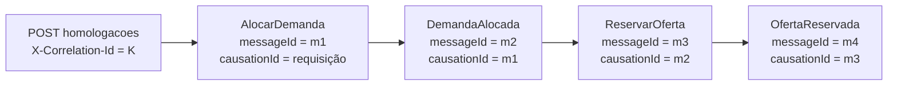

# Catálogo de mensagens

> Envelope, comandos, respostas e eventos trocados pelo RabbitMQ, com payloads, roteamento, correlação e versionamento. Os fluxos que usam estas mensagens estão em [`05-saga.md`](./05-saga.md); o transporte confiável (outbox, relay, inbox, retry e DLQ) está em [`02-dados-outbox.md`](./02-dados-outbox.md).

Este catálogo é a referência dos nomes: diagramas, tabelas e exemplos dos demais documentos usam exatamente os tipos e campos definidos aqui.

## 1. Tipos de mensagem

| Tipo | Significado | Exemplo | Quem envia | Quem consome |
|---|---|---|---|---|
| **Comando** | Pedido para um serviço específico executar uma ação; nome no imperativo | `ReservarOferta` | Compras (orquestrador) | Exatamente um participante |
| **Resposta** | Resultado de um comando: sucesso, rejeição ou compensação concluída; nome no particípio | `OfertaReservada` | Participante | Compras (orquestrador) |
| **Evento** | Fato de negócio já ocorrido, publicado para quem tiver interesse | `CompraConfirmada`, `EntregaRecebida` | Dono do fato | Um ou mais consumidores |

Todas as mensagens são gravadas no outbox do serviço emissor na mesma transação do efeito local e publicadas pelo relay. Nenhuma é enviada diretamente ao broker pelo código de negócio.

## 2. Envelope

Toda mensagem tem o mesmo envelope; o conteúdo específico fica em `payload`.

| Campo | Tipo | Obrigatório | Descrição |
|---|---|---|---|
| `messageId` | UUID | Sim | Identidade única da mensagem; chave da inbox do consumidor |
| `type` | texto | Sim | Nome canônico (por exemplo, `AlocarDemanda`) |
| `schemaVersion` | inteiro | Sim | Versão do formato do `payload` deste `type` |
| `occurredAt` | data ISO 8601 com fuso | Sim | Momento do fato ou da emissão do comando |
| `correlationId` | UUID | Sim | Identifica a operação de origem do usuário; é o `X-Correlation-Id` da requisição HTTP que iniciou o fluxo e se repete em toda a cadeia |
| `causationId` | UUID | Sim | `messageId` da mensagem que causou esta; na primeira mensagem, o identificador da requisição HTTP |
| `aggregateId` | UUID | Sim | Agregado de origem no serviço emissor |
| `aggregateVersion` | inteiro | Sim | Versão do agregado após o efeito; ordena mensagens do mesmo agregado |
| `sagaId` | UUID | Em mensagens da SAGA | SAGA a que a mensagem pertence |
| `operationId` | UUID | Em comandos e respostas da SAGA | Identifica o passo; repete-se em todo reenvio do mesmo comando e na resposta correspondente |
| `payload` | objeto | Sim | Conteúdo específico do tipo |

Convenções do payload seguem a base comum: IDs em UUID, nomes em `camelCase`, quantidades com unidade explícita (`{"valor": "100.00", "unidade": "kg"}`), valores monetários em decimal com moeda e datas ISO 8601 com fuso.

### 2.1 Exemplo completo

```json
{
  "messageId": "6a1f2c4e-8b3d-4e7a-9f10-2c5d7e8a9b01",
  "type": "ReservarOferta",
  "schemaVersion": 1,
  "occurredAt": "2026-11-10T14:00:05-03:00",
  "correlationId": "c0a8e7d2-1111-4c3b-8a2e-5f6d7e8f9a00",
  "causationId": "3e9b7a10-2222-4d5c-9b3f-6a7b8c9d0e11",
  "aggregateId": "8f14e45f-ceea-4e7a-a1b2-c3d4e5f60718",
  "aggregateVersion": 3,
  "sagaId": "b7c6d5e4-3333-4f2a-8c1d-0e9f8a7b6c55",
  "operationId": "d4e5f6a7-4444-4b8c-9d0e-1f2a3b4c5d66",
  "payload": {
    "compraId": "8f14e45f-ceea-4e7a-a1b2-c3d4e5f60718",
    "ofertaId": "1a2b3c4d-5555-4e6f-8a9b-0c1d2e3f4a77",
    "produtorId": "9e8d7c6b-6666-4a5b-8c7d-6e5f4a3b2c88",
    "quantidade": {"valor": "100.00", "unidade": "kg"}
  }
}
```

Neste exemplo, `aggregateId` é a Compra (o orquestrador é o emissor) e `causationId` é o `messageId` da `DemandaAlocada` que levou o orquestrador a enviar este comando.

### 2.2 Correlação de uma SAGA



Todas as mensagens carregam `correlationId = K` e o mesmo `sagaId`. As N SAGAs de uma homologação compartilham o `correlationId` (vieram da mesma requisição) e se distinguem pelo `sagaId`. Com `causationId`, os logs reconstroem a cadeia exata de causa e efeito de cada compra.

## 3. Comandos da SAGA

Todos são emitidos por Compras. A coluna "Respostas" lista as únicas respostas válidas para cada comando.

| Comando | Destino | Payload | Respostas |
|---|---|---|---|
| `AlocarDemanda` | Editais | `compraId`, `editalId`, `itemEditalId`, `quantidade` | `DemandaAlocada` ou `AlocacaoDemandaRejeitada` |
| `ReservarOferta` | Ofertas | `compraId`, `ofertaId`, `produtorId`, `quantidade` | `OfertaReservada` ou `ReservaOfertaRejeitada` |
| `AgendarEntrega` | Entregas | `compraId`, `escolaId`, `itemEditalId`, `produtorId`, `quantidade`, `janelaEntrega {inicio, fim}` | `EntregaAgendada` ou `AgendamentoRejeitado` |
| `LiberarDemanda` | Editais | `compraId`, `itemEditalId`, `operacaoOriginalId` | `DemandaLiberada` |
| `LiberarOferta` | Ofertas | `compraId`, `ofertaId`, `operacaoOriginalId` | `OfertaLiberada` |
| `CancelarAgendamento` | Entregas | `compraId`, `operacaoOriginalId` | `AgendamentoCancelado` |

- `janelaEntrega` é derivada do prazo do edital.
- Nas compensações, `operationId` do envelope identifica a própria compensação e `operacaoOriginalId` é o `operationId` do comando que ela desfaz. É por esse campo que o participante encontra a reserva, ou registra a operação original como `CANCELADA` quando ela ainda não chegou (ver [`05-saga.md`](./05-saga.md), seção 9.3).

### 3.1 Exemplos de payload

`AlocarDemanda`:

```json
{
  "compraId": "8f14e45f-ceea-4e7a-a1b2-c3d4e5f60718",
  "editalId": "2b3c4d5e-7777-4f6a-8b9c-0d1e2f3a4b99",
  "itemEditalId": "5e6f7a8b-8888-4c9d-8e0f-1a2b3c4d5eaa",
  "quantidade": {"valor": "100.00", "unidade": "kg"}
}
```

`AgendarEntrega`:

```json
{
  "compraId": "8f14e45f-ceea-4e7a-a1b2-c3d4e5f60718",
  "escolaId": "7c8d9e0f-9999-4a1b-8c2d-3e4f5a6b7cbb",
  "itemEditalId": "5e6f7a8b-8888-4c9d-8e0f-1a2b3c4d5eaa",
  "produtorId": "9e8d7c6b-6666-4a5b-8c7d-6e5f4a3b2c88",
  "quantidade": {"valor": "100.00", "unidade": "kg"},
  "janelaEntrega": {"inicio": "2026-11-20", "fim": "2026-11-30"}
}
```

`LiberarOferta`:

```json
{
  "compraId": "8f14e45f-ceea-4e7a-a1b2-c3d4e5f60718",
  "ofertaId": "1a2b3c4d-5555-4e6f-8a9b-0c1d2e3f4a77",
  "operacaoOriginalId": "d4e5f6a7-4444-4b8c-9d0e-1f2a3b4c5d66"
}
```

## 4. Respostas dos participantes

Toda resposta repete o `sagaId` e o `operationId` do comando que a originou.

| Resposta | Emissor | Resultado | Payload |
|---|---|---|---|
| `DemandaAlocada` | Editais | Saldo do item reservado | `compraId`, `itemEditalId`, `alocacaoDemandaId`, `quantidade` |
| `AlocacaoDemandaRejeitada` | Editais | Nada reservado | `compraId`, `itemEditalId`, `motivo` |
| `OfertaReservada` | Ofertas | Produção reservada | `compraId`, `ofertaId`, `reservaOfertaId`, `quantidade` |
| `ReservaOfertaRejeitada` | Ofertas | Nada reservado | `compraId`, `ofertaId`, `motivo` |
| `EntregaAgendada` | Entregas | Capacidade reservada e entrega agendada | `compraId`, `entregaId`, `agendamentoId`, `dataEntrega` |
| `AgendamentoRejeitado` | Entregas | Nada agendado | `compraId`, `motivo` |
| `DemandaLiberada` | Editais | Saldo devolvido ou operação marcada cancelada | `compraId`, `itemEditalId`, `resultado` |
| `OfertaLiberada` | Ofertas | Quantidade devolvida ou operação marcada cancelada | `compraId`, `ofertaId`, `resultado` |
| `AgendamentoCancelado` | Entregas | Agendamento cancelado ou operação marcada cancelada | `compraId`, `resultado` |

- `motivo` é um objeto `{code, message}` com um dos códigos da seção 4.2.
- `resultado` nas respostas de compensação vale `DESFEITO` (havia efeito e ele foi revertido) ou `SEM_EFEITO` (a operação original não existia e foi registrada como `CANCELADA`). Nos dois casos a compensação está concluída.
- Compensações não têm resposta de rejeição: liberar uma reserva sempre é permitido.

### 4.1 Exemplos de payload

`EntregaAgendada`:

```json
{
  "compraId": "8f14e45f-ceea-4e7a-a1b2-c3d4e5f60718",
  "entregaId": "0f1e2d3c-aaaa-4b5a-8c6d-7e8f9a0b1ccc",
  "agendamentoId": "4d5c6b7a-bbbb-4e3f-8a2b-1c0d9e8f7ddd",
  "dataEntrega": "2026-11-25"
}
```

`AgendamentoRejeitado`:

```json
{
  "compraId": "8f14e45f-ceea-4e7a-a1b2-c3d4e5f60718",
  "motivo": {
    "code": "CAPACIDADE_INDISPONIVEL",
    "message": "Sem capacidade logística para 100.00 kg na janela de 2026-11-20 a 2026-11-30"
  }
}
```

`DemandaLiberada`:

```json
{
  "compraId": "8f14e45f-ceea-4e7a-a1b2-c3d4e5f60718",
  "itemEditalId": "5e6f7a8b-8888-4c9d-8e0f-1a2b3c4d5eaa",
  "resultado": "DESFEITO"
}
```

### 4.2 Códigos de rejeição

| Código | Resposta | Situação |
|---|---|---|
| `SALDO_INSUFICIENTE` | `AlocacaoDemandaRejeitada` | O saldo do item do edital é menor que a quantidade da compra |
| `EDITAL_INDISPONIVEL` | `AlocacaoDemandaRejeitada` | Edital não está mais publicado (encerrado ou cancelado) |
| `OFERTA_INSUFICIENTE` | `ReservaOfertaRejeitada` | A quantidade disponível da oferta é menor que a da compra |
| `OFERTA_INATIVA` | `ReservaOfertaRejeitada` | Oferta desativada pelo produtor após o envio da proposta |
| `CAPACIDADE_INDISPONIVEL` | `AgendamentoRejeitado` | Sem capacidade logística na janela de entrega |
| `OPERACAO_CANCELADA` | Qualquer rejeição | O comando chegou depois da sua compensação e não foi aplicado |

O código vira o `motivo_falha` da SAGA e é exibido no acompanhamento da compra.

## 5. Eventos de negócio

| Evento | Emissor | `aggregateId` | Payload | Consumidores |
|---|---|---|---|---|
| `CompraCriada` | Compras | Compra | `compraId`, `planoAlocacaoId`, `propostaId`, `editalId`, `editalTitulo`, `itemEditalId`, `produto`, `produtorId`, `produtorNome`, `escolaId`, `escolaNome`, `quantidade` | Projeção `AcompanhamentoCompra` |
| `SagaProgrediu` | Compras | Compra | `compraId`, `sagaId`, `estadoSaga`, `etapa`, `motivoFalha` (opcional) | Projeção |
| `CompraConfirmada` | Compras | Compra | `compraId`, `entregaId`, `dataEntrega` | Projeção |
| `CompraCancelada` | Compras | Compra | `compraId`, `motivo` | Projeção |
| `EntregaRecebida` | Entregas | Entrega | `entregaId`, `compraId`, `escolaId`, `quantidadeRecebida`, `recebidoEm` | Compras (marca `RECEBIDA` e libera pagamento) |
| `CompraRecebida` | Compras | Compra | `compraId`, `entregaId`, `recebidoEm` | Projeção |
| `LiberacaoPagamentoRegistrada` | Compras | Compra | `compraId`, `liberacaoPagamentoId`, `valor {valor, moeda}`, `liberadoEm` | Projeção; ponto de integração financeira futura |

- `CompraCriada` carrega os nomes de edital, escola, produtor e produto vindos dos **snapshots da proposta**, para que a projeção monte a linha completa sem consultar outros serviços.
- A projeção consome **apenas eventos de Compras**, todos com a Compra como agregado, para que a ordem por `aggregateVersion` seja válida (ver [`03-cqrs.md`](./03-cqrs.md)). Por isso a data da entrega chega por `CompraConfirmada`, e o recebimento por `CompraRecebida`, em vez dos eventos de Entregas.
- `EntregaAgendada` é a resposta de sucesso do passo 3 (seção 4) e é consumida apenas pelo orquestrador.
- Os eventos de Compras também são o ponto de integração previsto para a base de conhecimento das etapas seguintes; nenhum consumidor novo exige mudança nos emissores.

`EntregaRecebida`:

```json
{
  "entregaId": "0f1e2d3c-aaaa-4b5a-8c6d-7e8f9a0b1ccc",
  "compraId": "8f14e45f-ceea-4e7a-a1b2-c3d4e5f60718",
  "escolaId": "7c8d9e0f-9999-4a1b-8c2d-3e4f5a6b7cbb",
  "quantidadeRecebida": {"valor": "100.00", "unidade": "kg"},
  "recebidoEm": "2026-11-25T09:30:00-03:00"
}
```

`LiberacaoPagamentoRegistrada`:

```json
{
  "compraId": "8f14e45f-ceea-4e7a-a1b2-c3d4e5f60718",
  "liberacaoPagamentoId": "6b7a8c9d-cccc-4f0e-9a1b-2c3d4e5f6eee",
  "valor": {"valor": "850.00", "moeda": "BRL"},
  "liberadoEm": "2026-11-25T09:30:02-03:00"
}
```

## 6. Roteamento no RabbitMQ

| Exchange | Tipo | Uso | Chave de roteamento |
|---|---|---|---|
| `campoconecta.comandos` | `direct` | Comandos da SAGA, cada um para um único serviço | `<servico-destino>.<Comando>` (por exemplo, `ofertas.ReservarOferta`) |
| `campoconecta.eventos` | `topic` | Respostas e eventos, para quem se inscrever | `<servico-emissor>.<Tipo>` (por exemplo, `entregas.EntregaAgendada`) |

| Fila | Serviço consumidor | Vínculos |
|---|---|---|
| `editais.comandos` | Editais | `editais.AlocarDemanda`, `editais.LiberarDemanda` |
| `ofertas.comandos` | Ofertas | `ofertas.ReservarOferta`, `ofertas.LiberarOferta` |
| `entregas.comandos` | Entregas | `entregas.AgendarEntrega`, `entregas.CancelarAgendamento` |
| `compras.saga` | Compras (orquestrador) | Respostas da seção 4 (`editais.*`, `ofertas.*`, `entregas.*`, exceto `entregas.EntregaRecebida`) |
| `compras.recebimentos` | Compras (recebimento e pagamento) | `entregas.EntregaRecebida` |
| `compras.projecao` | Compras (projetor do CQRS) | `compras.*` |

- Cada fila tem a fila de retry com TTL e a fila de mensagens mortas `<servico>.<tipo>.dlq` descritas em [`02-dados-outbox.md`](./02-dados-outbox.md), seção 9.
- Separar `compras.saga`, `compras.recebimentos` e `compras.projecao` isola falhas: uma projeção lenta não atrasa a SAGA, e um problema no recebimento não bloqueia novas compras.
- O orquestrador ignora qualquer resposta que não corresponda ao `operationId` pendente ou já registrado na SAGA.

## 7. Matriz de comandos e eventos

| Mensagem | Tipo | Emissor | Consumidor | Passo da SAGA |
|---|---|---|---|---|
| `AlocarDemanda` | Comando | Compras | Editais | 1 |
| `DemandaAlocada` | Resposta | Editais | Compras | 1 (sucesso) |
| `AlocacaoDemandaRejeitada` | Resposta | Editais | Compras | 1 (rejeição) |
| `ReservarOferta` | Comando | Compras | Ofertas | 2 |
| `OfertaReservada` | Resposta | Ofertas | Compras | 2 (sucesso) |
| `ReservaOfertaRejeitada` | Resposta | Ofertas | Compras | 2 (rejeição) |
| `AgendarEntrega` | Comando | Compras | Entregas | 3 |
| `EntregaAgendada` | Resposta | Entregas | Compras | 3 (sucesso) |
| `AgendamentoRejeitado` | Resposta | Entregas | Compras | 3 (rejeição) |
| `CancelarAgendamento` | Comando de compensação | Compras | Entregas | Compensa 3 |
| `AgendamentoCancelado` | Resposta | Entregas | Compras | Compensa 3 |
| `LiberarOferta` | Comando de compensação | Compras | Ofertas | Compensa 2 |
| `OfertaLiberada` | Resposta | Ofertas | Compras | Compensa 2 |
| `LiberarDemanda` | Comando de compensação | Compras | Editais | Compensa 1 |
| `DemandaLiberada` | Resposta | Editais | Compras | Compensa 1 |
| `CompraCriada` | Evento | Compras | Projeção | 0 |
| `SagaProgrediu` | Evento | Compras | Projeção | Cada transição |
| `CompraConfirmada` | Evento | Compras | Projeção | 4 |
| `CompraCancelada` | Evento | Compras | Projeção | Fim da compensação |
| `EntregaRecebida` | Evento | Entregas | Compras | Fora da SAGA |
| `CompraRecebida` | Evento | Compras | Projeção | Fora da SAGA |
| `LiberacaoPagamentoRegistrada` | Evento | Compras | Projeção | Fora da SAGA |

## 8. Deduplicação e ordem

| Garantia | Mecanismo |
|---|---|
| Mesma mensagem entregue duas vezes não repete efeito | Inbox por `messageId`, gravada na mesma transação dos efeitos |
| Mesmo comando reenviado pelo orquestrador (novo `messageId`) não repete efeito | Unicidade de negócio por `(compraId, operationId)` no participante; devolve a resposta original |
| Mensagem antiga não regride estado | `aggregateVersion`: o consumidor só aplica se for maior que a versão já registrada para o agregado |
| Nenhuma dependência de ordem global | Ordem garantida apenas por agregado; a SAGA envia um comando por vez, então só há uma mensagem pendente por compra em cada momento |

## 9. Versionamento das mensagens

- `schemaVersion` é por `type` e começa em `1`.
- **Mudança compatível** (novo campo opcional): mantém a versão. Consumidores ignoram campos desconhecidos.
- **Mudança incompatível** (remover ou renomear campo, mudar tipo ou significado): nova versão. O emissor passa a publicar a versão nova só depois que os consumidores aceitarem as duas; a versão antiga é removida quando nenhum emissor a usar.
- Mensagem com `type` desconhecido ou `schemaVersion` não suportada é erro permanente: não é reprocessada e vai direto para a DLQ (ver [`02-dados-outbox.md`](./02-dados-outbox.md), seção 9).
- Os nomes canônicos deste catálogo não mudam sem atualizar, no mesmo PR, os documentos que os usam.
