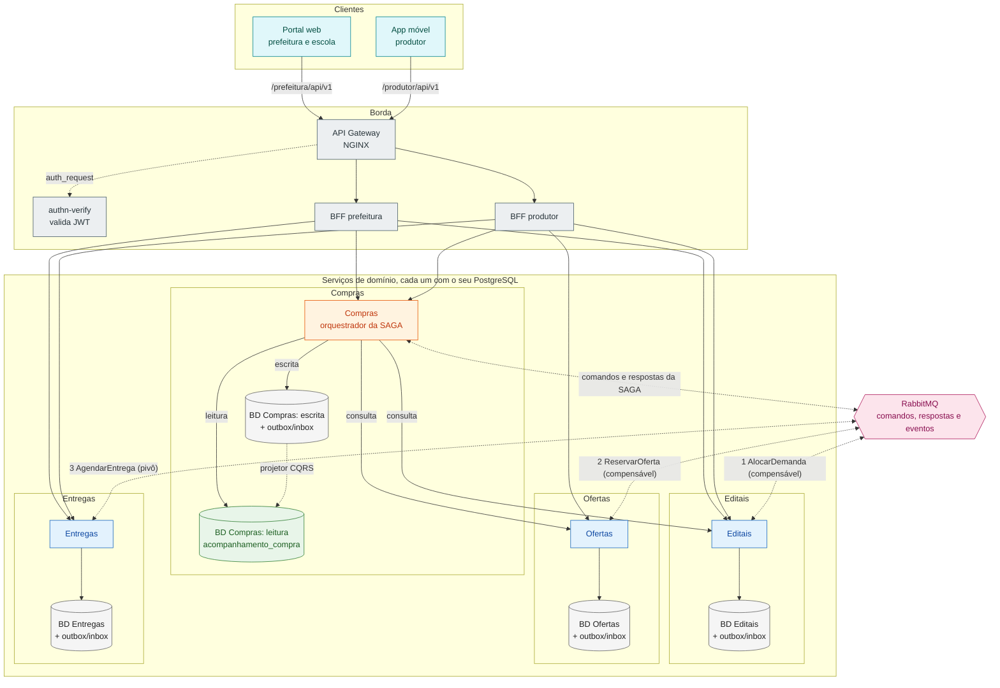
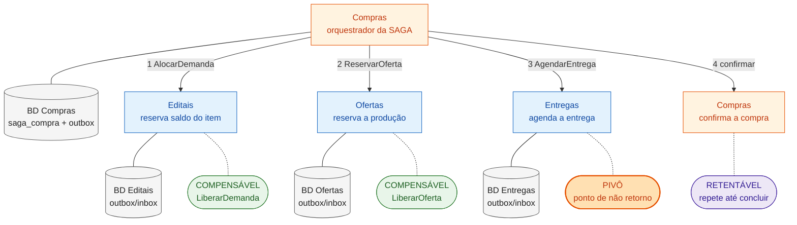

# Visão geral da arquitetura e comunicação

> Diagrama único do sistema: clientes, gateway, autenticação, BFFs, serviços de domínio, bancos, outbox/relay, RabbitMQ, CQRS e a SAGA aplicada sobre os serviços.
> Cada padrão tem o seu documento detalhado; este documento mostra como eles se encaixam. Detalhes em [`04-gateway-bffs.md`](./04-gateway-bffs.md), [`02-dados-outbox.md`](./02-dados-outbox.md), [`03-cqrs.md`](./03-cqrs.md), [`05-saga.md`](./05-saga.md) e [`06-mensagens.md`](./06-mensagens.md).

## 1. Diagrama geral

**Legenda**

| Elemento | Significado |
|---|---|
| Seta contínua | Chamada HTTP síncrona (requisição e resposta) |
| Seta tracejada de duas pontas | Mensagens assíncronas: o comando vai e a resposta volta. Cada mensagem é gravada no outbox do emissor, publicada pelo relay no RabbitMQ e registrada na inbox do consumidor |
| Seta tracejada "projetor CQRS" | Eventos de Compras atualizam o modelo de leitura |
| Números 1 a 3 | Passos da SAGA "confirmar compra" nos participantes; o passo 4, confirmar a compra, é local em Compras (seção 4) |
| Laranja | Compras, orquestrador da SAGA |
| Verde | Modelo de leitura do CQRS |

## 2. Componentes e responsabilidades

| Camada | Componente | Responsabilidade | Fala com |
|---|---|---|---|
| Clientes | Portal web | Prefeitura e escola: editais, homologação, acompanhamento e recebimento | Gateway |
| | App móvel | Produtor: editais compatíveis, ofertas, propostas e entregas | Gateway |
| Borda | API Gateway (NGINX) | Entrada única, roteamento por prefixo, CORS, limites de taxa, correlação | authn-verify, BFFs |
| | authn-verify | Valida o JWT e o papel compatível com o prefixo; devolve as claims confiáveis | — |
| | BFF prefeitura | Adapta e agrega respostas para o portal (dashboard, links HATEOAS) | Editais, Compras, Entregas |
| | BFF produtor | Adapta e agrega respostas para o app (tela inicial enxuta) | Editais, Ofertas, Compras, Entregas |
| Domínio | Editais | Prefeituras, escolas, editais e saldo dos itens | BD Editais, RabbitMQ |
| | Ofertas | Produtores e produção disponível | BD Ofertas, RabbitMQ |
| | Compras | Propostas, plano de alocação, compras; **orquestra a SAGA** e mantém o **modelo de leitura** | BD Compras, RabbitMQ, Editais e Ofertas (consulta) |
| | Entregas | Capacidade logística, agendamento e recebimento | BD Entregas, RabbitMQ |
| Dados | 4 PostgreSQL | Um banco por serviço, com tabelas de negócio, outbox e inbox | Só o serviço dono |
| Mensageria | RabbitMQ | Transporta comandos, respostas e eventos entre os serviços | Relays e consumidores |

Regras gerais:

- O gateway não tem regra de negócio; o BFF não acessa banco nem decide; quem decide é o serviço dono do dado.
- Nenhuma transação de banco atravessa serviços. A consistência entre serviços vem da SAGA e dos eventos.
- Todo efeito de negócio entre serviços é assíncrono, via outbox. HTTP entre serviços é usado só para **consulta**.

## 3. Como uma requisição percorre o sistema

### 3.1 Consulta: acompanhamento de compra (usa o CQRS)

| # | De → para | O que acontece | Tipo |
|---|---|---|---|
| 1 | Portal → Gateway | `GET /prefeitura/api/v1/compras/{id}/acompanhamento` com o JWT | HTTP |
| 2 | Gateway → authn-verify | Valida token e papel (`gestor` ou `escola`); sem token, `401` | HTTP interno |
| 3 | Gateway → BFF prefeitura | Encaminha sem o prefixo e com as claims confiáveis | HTTP |
| 4 | BFF → Compras | `GET /api/v1/compras/{id}/acompanhamento` | HTTP |
| 5 | Compras → BD Compras (leitura) | Uma consulta em `acompanhamento_compra`, sem chamar outros serviços | SQL local |
| 6 | BFF → Portal | Resposta adaptada ao portal, com links HATEOAS das ações permitidas | HTTP |

### 3.2 Escrita que dispara a SAGA: homologação do plano

| # | De → para | O que acontece | Tipo |
|---|---|---|---|
| 1 | Portal → Gateway → BFF → Compras | `POST /planos-alocacao/{id}/homologacoes` com `Idempotency-Key` | HTTP |
| 2 | Compras → BD Compras | Uma transação local: plano homologado, N compras `PENDENTE`, N SAGAs e os comandos no outbox | SQL local |
| 3 | Compras → Portal | `202 Accepted`: a homologação só **inicia** as SAGAs | HTTP |
| 4 | Relay → RabbitMQ → Editais, Ofertas, Entregas | Passos 1 a 3 da SAGA, um de cada vez | Assíncrono |
| 5 | Participantes → RabbitMQ → Compras | Respostas; Compras decide avançar ou compensar | Assíncrono |
| 6 | Compras → projeção | `CompraConfirmada` ou `CompraCancelada` atualiza `acompanhamento_compra` | Assíncrono |

## 4. A SAGA aplicada sobre a arquitetura

A SAGA "confirmar compra" é **orquestrada por Compras** e atravessa quatro serviços. Cada passo é uma transação local no banco do participante, com a mensagem seguinte gravada no outbox na mesma transação.

As setas do orquestrador representam comandos enviados pelo RabbitMQ (outbox → relay → broker → inbox do participante), como no diagrama geral.

| Passo | Serviço | Comando | Efeito local | Classificação | Se falhar depois |
|---|---|---|---|---|---|
| 0 | Compras | (interno) | Compra `PENDENTE`, SAGA `EM_ANDAMENTO` | Compensável | Compra marcada `CANCELADA` |
| 1 | Editais | `AlocarDemanda` | Reserva saldo do item do edital | **Compensável** | `LiberarDemanda` devolve o saldo |
| 2 | Ofertas | `ReservarOferta` | Reserva a produção do produtor | **Compensável** | `LiberarOferta` devolve a produção |
| 3 | Entregas | `AgendarEntrega` | Reserva capacidade e agenda a entrega | **Pivô** | Se rejeitado, compensa os passos 2 e 1; se confirmado, a SAGA vai até o fim |
| 4 | Compras | (interno) | Compra `CONFIRMADA`, SAGA `CONCLUIDA` | **Retentável** | Não falha por regra de negócio; é idempotente e repetido até concluir |

**Por que Entregas é o pivô:** é o último passo que pode ser **rejeitado por regra de negócio** (falta de capacidade na janela da escola). Antes dele, tudo pode ser desfeito; depois que ele confirma, o único passo restante é local em Compras e não tem motivo de negócio para falhar. `CancelarAgendamento` só é usado quando o resultado do agendamento é **desconhecido** (timeout), ou seja, quando o pivô ainda não foi decidido (ver [`05-saga.md`](./05-saga.md), seção 9).

**Cenário de falha resumido** (detalhado na seção 8 de [`05-saga.md`](./05-saga.md)): Entregas responde `AgendamentoRejeitado` → Compras envia `LiberarOferta` → Ofertas responde `OfertaLiberada` → Compras envia `LiberarDemanda` → Editais responde `DemandaLiberada` → Compra `CANCELADA` → `CompraCancelada` atualiza a projeção.

## 5. Redes na implementação (Parte 3)

A divisão em camadas do diagrama geral virou isolamento de rede no `docker-compose.yml`:

| Rede | Participantes | Interna? |
|---|---|---|
| `borda` | gateway, authn-verify, BFFs | Não (o gateway publica `127.0.0.1:8080`) |
| `aplicacao` | BFFs e os quatro serviços | Não |
| `mensageria` | os quatro serviços e o RabbitMQ | Sim |
| `dados-<serviço>` | um banco e o serviço dono | Sim |

Assim, o BFF alcança as APIs mas não alcança nenhum banco, e cada banco só é alcançável pelo próprio serviço.

## 6. O que já está implementado e o que é projeto

| Elemento | Situação |
|---|---|
| Gateway, authn-verify (JWT de desenvolvimento), dois BFFs | Implementados e em execução (Parte 3) |
| Quatro serviços com banco próprio, volumes e redes isoladas | Implementados e em execução (Parte 3) |
| RabbitMQ com volume e healthcheck | Em execução, ainda sem filas da SAGA (Parte 3) |
| SAGA orquestrada, outbox/relay, inbox e projeção CQRS | Projetados nesta Parte 2; implementação e demonstração com falha e compensação na **Parte 4** |
