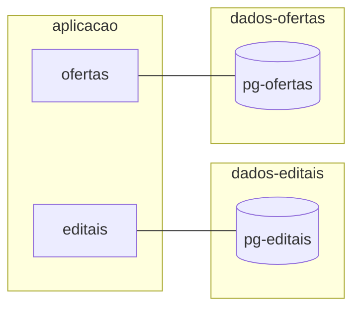

# Bancos de dados e persistência

## Quatro instâncias, um banco por serviço

| Contêiner | Banco | Usuário da aplicação | Volume nomeado | Rede |
|---|---|---|---|---|
| `pg-editais` | `editais` | `app_editais` | `pg-editais-dados` | `dados-editais` |
| `pg-ofertas` | `ofertas` | `app_ofertas` | `pg-ofertas-dados` | `dados-ofertas` |
| `pg-compras` | `compras` | `app_compras` | `pg-compras-dados` | `dados-compras` |
| `pg-entregas` | `entregas` | `app_entregas` | `pg-entregas-dados` | `dados-entregas` |

Os nomes `pg-<serviço>` substituem os `<serviço>-db` usados como referência na Parte 2 ([`02-dados-outbox.md`](../parte2/02-dados-outbox.md), seção 2).

## Imagem customizada

[`infra/postgres/Dockerfile`](../../infra/postgres/Dockerfile) parte de `postgres:16-alpine` e acrescenta:

- **Usuário da aplicação sem superusuário.** O script [`01-usuario-aplicacao.sh`](../../infra/postgres/init/01-usuario-aplicacao.sh) cria `app_<serviço>` (`NOSUPERUSER NOCREATEDB NOCREATEROLE`), torna esse usuário dono apenas do próprio banco e revoga o acesso de `PUBLIC`. O superusuário `admin` existe só para administração e nenhuma aplicação o usa.
- **Parâmetros do servidor:** `max_connections=50`, fuso `America/Sao_Paulo`, log de consultas acima de 500 ms e log de conexões.
- **Healthcheck** com `pg_isready`. O compose só inicia o serviço quando o banco está saudável (`depends_on: condition: service_healthy`).

O script de inicialização roda **só quando o volume está vazio**. Por isso, trocar senha no `.env` depois da primeira subida exige `docker compose down -v`, que apaga os dados.

## Isolamento por rede

Cada banco fica **só** na sua rede `dados-<serviço>`, marcada como `internal: true` (sem rota para fora do host). Apenas o serviço dono participa dessa rede. Os demais serviços, os BFFs e o gateway não resolvem nem alcançam o banco.



Teste: o serviço `ofertas` não enxerga `pg-editais`:

```bash
docker compose exec ofertas python -c "import socket; socket.gethostbyname('pg-editais')"
# socket.gaierror: [Errno -3] Temporary failure in name resolution

docker compose exec editais python -c "import socket; print(socket.gethostbyname('pg-editais'))"
# 172.22.0.2   (o dono alcança o próprio banco)
```

## Migrações

Cada serviço aplica `migrations/*.sql` ao iniciar ([`app/migracoes.py`](../../servicos/editais/app/migracoes.py)). A tabela `schema_migracoes` registra o que já rodou, e um `pg_advisory_lock` garante que, com várias réplicas (`--scale`), só uma aplica as migrações enquanto as outras esperam.

## Demonstração de persistência

PowerShell (Windows):

```powershell
# 1. sobe e cria um dado (porta publicada só no override de desenvolvimento)
docker compose -f docker-compose.yml -f docker-compose.dev.yml up -d --build
$p = Invoke-RestMethod -Method Post -Uri http://localhost:8001/api/v1/prefeituras `
  -ContentType "application/json" `
  -Headers @{ "Idempotency-Key" = [guid]::NewGuid().ToString() } `
  -Body '{"nome":"Prefeitura Exemplo","cnpj":"12345678000190"}'
$p

# 2. derruba TODOS os contêineres (sem -v: os volumes ficam)
docker compose down
docker volume ls

# 3. sobe de novo: o dado continua lá
docker compose -f docker-compose.yml -f docker-compose.dev.yml up -d
Invoke-RestMethod http://localhost:8001/api/v1/prefeituras/$($p.id)

# 4. contraprova: com -v os volumes são apagados e o dado some
docker compose down -v
```

Bash (Git Bash, Linux, macOS):

```bash
# 1. sobe e cria um dado (porta publicada só no override de desenvolvimento)
docker compose -f docker-compose.yml -f docker-compose.dev.yml up -d --build
curl -s -X POST http://localhost:8001/api/v1/prefeituras \
  -H "Content-Type: application/json" \
  -H "Idempotency-Key: $(uuidgen || cat /proc/sys/kernel/random/uuid)" \
  -d '{"nome":"Prefeitura Exemplo","cnpj":"12345678000190"}'

# 2. derruba TODOS os contêineres (sem -v: os volumes ficam)
docker compose down
docker volume ls | grep pg-

# 3. sobe de novo: o dado continua lá
docker compose -f docker-compose.yml -f docker-compose.dev.yml up -d
curl -s http://localhost:8001/api/v1/prefeituras/<id-devolvido-no-passo-1>

# 4. contraprova: com -v os volumes são apagados e o dado some
docker compose down -v
```

Para ver direto no banco:

```bash
docker compose exec pg-editais psql -U admin -d editais -c "SELECT id, nome FROM prefeitura;"
```
